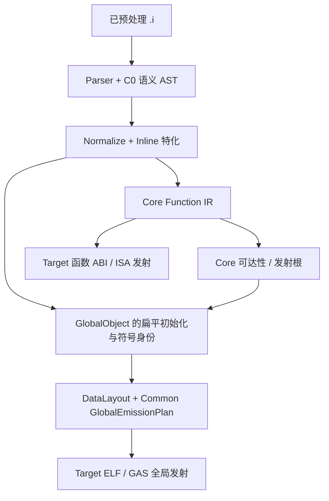

# MiniC 编译器架构总入口：事实、问题、清理与文档导航

> **持续维护的入口，不是第五份问题台账。** 第八轮复扫基线：
> `refactor/minic-target-language-boundary` / `3d504e7ee4a7`，2026-10-31。
> 本页 A8-01～A8-20 的初次源码取证基线是 `f6e9eb870d80`；
> 新旧完整 `src/` 对照只有 x86-64 的三个源文件变化，其他路径逐文件内容相同。
> 范围仅为 MiniC **编译器**：`tools/minic`、`tools/minic-cc`、
> `src/{frontend,compiler,core,target}`；不将 MiniPP、MiniAS、MiniLD、NaSeed
> 的实现和验收混入编译器结论。对源码的静态检查不等于 GNU AS、ELF 或运行时验证。

## 0. 从哪里开始，哪里才是事实来源

| 要回答的问题 | 唯一持续维护的事实来源 | 本索引的作用 |
| --- | --- | --- |
| 项目的设计边界是什么 | [架构原则](principles.md) | 列出偏离与验收条件，不另立原则 |
| `.i` 如何流过 AST、Core、全局对象与后端 | [生产数据流及所有权图谱](minic-global-contract-map.md) | 更新当前源码核验的变化，不复制完整图谱 |
| 一个函数谁调用、借用、修改、释放 | [函数契约台账](minic-function-contract-register.md) | 指向原条目及仍未深读之处 |
| 完整扫描了哪些文件，还剩哪些盲区 | [第八轮 341 输入文件覆盖清单](minic-source-coverage-f8-2026-10-31.md) | 以 `3d504e7` 冻结文件基线，逐文件追踪 F1/R2/E；现行源码删去旧 `.c` 后另计 |
| 有哪些 Bug、调查项、架构债、已排除误判 | [MC 问题台账](minic-issue-register.md) | 只组织主题和工作依赖，**不复制状态** |
| 某个旧重构批次当时做了什么 | [历史审查与 RFC](#6-历史资料与专题索引) | 标出它是快照、方案还是现行契约 |

`minic-issue-register.md` 已维护 `MC-001`～`MC-087` **87 个永久编号**：
第十一轮 F11 基线 `eddd49c` 大批复扫新增 MC-078～MC-087，原 77 个编号和证据全部保留；
MC-031 在定向清理后为 `FIXED-UNVERIFIED`，**不将局部资源补漏误计为 MC-043 的语义修复**。
当前计数：**59 `OPEN`、11 `INVESTIGATING`、11 `DEBT`、4 `FIXED-UNVERIFIED`、
2 `CLOSED-NOT-A-BUG`**；MC-076 虽通过已知 mixed-use 定向修复仍因间接地址传播不完整而 `OPEN`。
最新状态及每个编号以[唯一 MC 台账](minic-issue-register.md)为准。
函数台账最新 F7 的 212 项是函数/函数组级静态审读，不是全仓所有函数均已逐行证明。

记录规则：新发现先在本页的[待补证据表](#3-本轮新增的待补证据和清理接缝)保持可见；
确认需要长期追踪时为其分配下一个 `MC-xxx`，补进唯一 MC 台账并回链；
即便该项暂不修复，也必须保留 producer、consumer、旧路径及退出条件。
动态复现、源码推导、历史 CI 记录必须分别标注。

## 1. 当前代码与真实数据流

`src/` 第十轮当前有 **336 个 C/H 文件**：Frontend 69、Compiler 11、Core 48、Target 208；
另外单独审查两个编译器入口。第八轮 `3d504e7` 基线为 337 个
（Frontend 70），随后退役的 `parser_type_query.c` **不从冻结的 F8 覆盖清单中抹掉**。
旧图谱中的 332 个是更早历史口径，不能作为本 HEAD 的覆盖率。

`src/compiler/compiler.c:315–374` 的关键顺序是：
整数/符号/布尔 inline 特化 → Core 函数集合 → **函数剪枝 → 静态对象剪枝 → 再次函数剪枝**
→ Core/Layout 验证 → 汇编发射。三次剪枝有不同的闭包依赖，尚不能因为名字重复就删除。

现在的 PARSED / NORMALIZED 是语义 AST 的阶段性表示与归一化替换事务，
**不能未经核实称为两棵长期同步修改的独立 AST 实体树**。
Core IR 存在函数路径；GlobalObject 作为并行的 TU 全局数据路径进入 Common 发射，
不是每个 global 都必须先变成 Core 函数 IR。

## 2. 目录结构与职责边界：先记问题，不立即大搬家

| 现有目录/接口 | 已确认的责任 | 需要核查或清理的边界 | 目录调整的约束 |
| --- | --- | --- | --- |
| `src/frontend/` | 词法、C/GNU 语法、源类型、表达式/声明语义和 C0 Program | Parser 与 Sema 交错、Local/Record 数组双表示、三路 static 数组声明 | 先统一类型及声明的 producer/consumer，再讨论把 Parser/Sema 物理分目录；不能用移动文件假装分层 |
| `src/compiler/` | 流水线、特化、引用/保活与 CoreSet | 实例化 CALL 身份写入共享 AST，函数/对象根闭包的阶段关系 | 这是合理的阶段编排目录，暂不把剪枝机械合并 |
| `src/core/` | Core IR、CFG、表达式求值、事实、source GNU ASM 语义 | 跳过循环事实屏障的入口、Record 布局回查 C0、源循环形状的隐式 provenance | 首先明确 Core 输入合同；`source_loop_shapes` 仍有 `goto`/`continue` 消费者 |
| `src/target/` | TargetInfo、DataLayout、catalog、backend 边界 | Source policy、数据布局与机器能力汇合处的所有权 | DataLayout 留在 Target 有目标布局的正当依据，不能为“去 C 化”一概上移 |
| `src/target/common/` | 五目标共享遍历、事实/存储计划、全局序列化和输出事务 | RV32/64 尚未完全使用 GlobalEmissionPlan；部分 Common 同时接触 C0 与 Core | 先复用现成 Plan 并删旧分类，勿新增平行 Global IR |
| `src/target/source_policy/` | 目标拥有的 GNU ASM 源形式准入 | Source qualifier 与 machine consumer 的形式身份交接 | 源资格不等于主动生成的 ISA；不是“放错 target”就该删除 |
| `src/target/{riscv,riscv32,riscv64}/` | 共用 RISC-V 原语与分 XLEN/ABI 发射 | RV32/RV64 全局发射重复，RV64 record copy 有可清理手写路径 | 不合并 ILP32/LP64 帧、GPR 分配和目标 psABI 差异 |
| `src/target/{x86_64,aarch64,loongarch64}/` | 各自 ABI、机器代码及特殊 ASM | x86 typed/legacy ASM 共存；A64/Loong 部分 record 复制与大小限制 | 只清理算法选择的重复，不抹平真实 ISA/ABI 差异 |

**文件夹重排不是第一批“清理旧实现”。** 先列出头文件依赖、真实消费者、构建清单及测试路径；
完成接口迁移后，物理移动和删除旧路径应在同一批次清账。否则目录看着整齐，代码仍是两套。

## 3. 本轮新增的待补证据和清理接缝

下表的 `A8-*` 是**本轮审查索引**，不是新的 MC 缺陷编号。它们在补充 MC 台账之前不能静默消失；
`SOURCE` 表示仅静态生产者/消费者证据，`DIFF-HISTORY` 表示引用仓库既存差分，
`PLAN` 表示清理依赖而非现存错编。

| 审查项 | 事实与可查入口 | 关联旧项 / 证据 | 完成与删除条件 |
| --- | --- | --- | --- |
| **A8-01 局部/成员数组双轨** | `frontend/ast.c:1614–1735` 的 `MinicArrayObjectInfo` 同时支持正式 ArrayType 与旧 `is_array+count`；`parser_postfix.c:25–52` 可临时造 descriptor | `SOURCE`；关联 [数组表示契约](representation-seams-and-deferred-ir.md) | 先让 Core、verifier、初始化器、布局消费完整类型，再撤旧 adapter；VLA/柔性数组需独立语义 |
| **A8-02 数组复合字面量倒退** | `parser_expression.c:601–667` 将已有 ArrayType 拆成旧 Local；`ast_verifier.c:915–950`、`core_lower_address.c:89–149` 强制消费旧形式 | `SOURCE` | 先改两个 consumer 保持 initializer 执行时机，再改 producer，最后删旧分支 |
| **A8-03 static 数组三入口** | `parser_global.c:639–822,1013–1190`、`parser_static_initializer.c:3312–3527` 重复 begin/merge/属性；已有 `declaration_sema.c` 和统一 static initializer | `SOURCE / PLAN` | 合流 canonical object type 与声明生命周期；保留 tentative/incomplete、GNU zero-length、属性与 redeclaration 的合法差异 |
| **A8-04 CALL 实例身份** | 整数/符号/布尔 pass 修改共享 CALL；`core_lower_calls.c:746–768` scalar 做三个选择，`:909–930` record return 直接用 AST callee | `SOURCE`；已证根因 `MC-006/007/008` | `(caller FunctionId, CALL ExpressionId)` + 事实/section 唯一解析目标；迁移 `inline_reference.c` 保活扫描及常量证明后删除 AST 改写 |
| **A8-05 continue 循环事实屏障** | `core_lower.c:1302–1325` 的 LABEL+WHILE 直进 `minic_core_lower_loop_cfg`；普通路径 `core_lower_loop.c:481–519` 先使可变特化参数失效 | `SOURCE`，**尚未运行**；独立于 `MC-033` | 用特化参数+`continue` 做 GNU 差分，再让所有 CFG 入口共享事实有效性合同；保留可重入标签 |
| **A8-06 Core Record 布局** | Core `RECORD_LOAD/COPY` 不完全携尺寸/对齐，`riscv64/legalize.c:55–115` 回查 C0 Program + DataLayout | `SOURCE` | 仅补执行所需布局合同；已存在的 Core enum 元数据及已剥离的 `is_initializer_write` 不应重做 |
| **A8-07 RV 全局 ELF 分类** | RV32 `rv32_global_emit.c:40–61`、RV64 `global_emit.c:429–453` 的 `.bss.* @progbits`、默认零对象 `.data` 与 Common Plan 的 `@nobits`/`.bss` 不同 | `SOURCE`，**缺 RV GNU AS/readelf**；相关 `MC-025/046` 不同根因 | 先做真实 RV32/64 ELF oracle；保留 alias/extern 先行分流，再接现有 GlobalEmissionPlan，最后删旧分类 |
| **A8-08 RV64 TargetInfo 传递** | `riscv64/codegen_function.c:27–40` 尚丢弃传入 target；global emit 内有 default layout/重新选目标 | `SOURCE / PLAN` | 显式传 invocation Target 与 Layout，保持产物后再迁移 Common Plan |
| **A8-09 RV enum/record copy** | `riscv64/codegen_support.c:242–325` 机器查询 C0 enum；`call_emit.c:233–260`、`core_codegen.c:388–415` 手写 byte-copy，对应现成 `riscv/record_copy_bytes.c` | `SOURCE / PLAN` | 先迁移 Core enum facts；按寄存器活性/别名核对复制原语，再删除重复循环 |
| **A8-10 x86 ASM 双契约** | `x86_64/asm_contract.c` 109 组源 policy：21 typed、88 legacy；机器端仍重新按字符串分类 | `SOURCE`；相关 `MC-050/062` 已有既存差分 | 每家族迁入 typed form + 正反例/ELF，删除对应旧 matcher；保留机器端防伪校验和异常表语义 |
| **A8-11 x87 运算身份** | `x86_64/machine_call.c:288–551` 从 `__addtf3` 等名字重新辨认 `long double` 运算 | `SOURCE`；关联 `MC-041/051` | 明确 Core 的扩展浮点操作身份，再决定 x87/软浮点 lowering；不能先删现役 helper |
| **A8-12 LP64 大聚合复制** | `common/lp64_aggregate.c:124–137` + A64/Loong return helper 2048B 人为上限；A64 ingress 按字节展开，Loong 已循环复制 | `SOURCE`，已有 `MC-060` 差分 | 先复用 A64 本地 counted-copy，修宽长度计数、保留 ABI 隐藏指针；再解除多处 cap 并测 2049B+ |
| **A8-13 Loong 地址折叠扫描** | `loongarch64/residual_emit.c:45–123` 对每候选重复扫全函数，可构造二次方工作量 | `SOURCE`，无性能基准 | 缓存每函数 use/provenance 判定后替换热路径；保留保守不折叠条件 |
| **A8-14 Core fact/标签重复扫描** | `core_lower_if.c` 自有 fact snapshot 重叠 `local_facts.c`；`core_lower.c:1074–1123` 标签所有权全表扫描 | `SOURCE`；关联 `MC-029/040` | 先收敛 facts fork/meet 和 reentry owner 查询；不能合并证明强度不同的 Bool oracle |
| **A8-15 Core 个案打印与死 API** | `core_lower.c`、`core_lower_if.c` 六处无开关 `genl_op_from_split` stderr 输出；两个未调用 parser helper | `SOURCE`；已有 `MC-020/031` | 简单删除须先核对 `rg`/构建；保留其他有环境开关的诊断 |
| **A8-16 静态对象/标签保活** | Core function prune 与静态对象 prune 相互依赖；GNU ASM symbol 与 computed-goto label 是非显式 CALL 根 | `SOURCE`，已知 `MC-064/072`；`MC-073` 尚调查 | 建立根类型与实际发射关系，不直接删三次剪枝或 GlobalObject owner/force-emit 字段 |
| **A8-17 现行文档/目录漂移** | 95 份架构材料平铺；living 图谱仍使用旧 332 文件和单次 prune 摘要 | `SOURCE / DOC` | 本入口统一导航、更新当前补注；之后按链接迁移历史文件，不直接丢弃审查记录 |
| **A8-18 Backend 头文件两种职责** | `target/backend.h:24–110` 同时声明最终 program emission 和源 ASM 资格契约；`core_lower_asm_target.c:17–64` 在 Core 构造期调用资格服务 | `SOURCE / PLAN` | 先拆窄的 source-qualification 声明/头文件与最终 emission API；保留目标判定时序，不新增架构枚举 |
| **A8-19 TargetInfo 接口宽度** | `target/target_info.h:88–131` 同时提供源类型、ABI、PIC、x86/Loong/RV 选项，并包含 `riscv/isa_features.h` | `SOURCE / PLAN` | 先按真实消费者分窄查询和 invocation 视图，不复制 TargetInfo，也不把 DataLayout 整体移走 |
| **A8-20 FunctionBody 发射政策** | `frontend/function_body.c:728,797` 同时有 Body 所有权核验与 inline emission reference 重算；Compiler 在两种阶段调用 | `SOURCE / PLAN` | 复核与 `compiler/core_reachability.c` 的根闭包关系；保留 Frontend 通用遍历，逐步让 Compiler 拥有发射决策 |
| **A8-21 x86 early-head 地址身份** | `3d504e7` 的 `x86_64/codegen.c:108–154` 用每函数、每 global 布尔标志将物理解引用与 VMA 取址合为同一种地址表示。第十轮用同符号、双执行顺序及异址执行获得真实 wrongcode。 | `GNU-NATIVE-DIFF/ELF-ORACLE`；**升级 [MC-076](minic-issue-register.md#mc-076-x86-early-head-同一全局符号混合物理访问与链接-vma-地址错编)**：GNU 2/2 PASS，旧 MiniC 2/2 FAIL，见永久 x86 fixture。 | 重写按 SSA/use-role 的发射合同；共享 SSA、helper 逃逸与动态偏移都应审查。直接用例通过不代表未知别名/间接内存访问已解决。 |
| **A8-22 RV64 Record snapshot 扫描** | `riscv64/frame_layout.c` 两轮按每个 Record object 调用 `record_snapshot.c:158–218`，每次又查 defining CALL、对象使用与基本块 | `SOURCE / PLAN`；与 `F7-R33～R36` 的正确性证明同一用途，尚无性能实测 | 预建函数级对象定义/使用/块位置信息，保持唯一使用、未逃逸、same-block 证明；对大 Record 参数测试回归，之后删除重复全函数扫描 |
| **A8-23 已有问题与源码状态复核** | `MC-052` AArch uaccess、`MC-066` 指针成员 ABI 路径在当前源码已有对应修正分支，MC 仍 `OPEN` | `SOURCE`，需目标 GNU/ELF/执行验证 | **不自动关闭**；补同 HEAD 目标回归后更新 MC 为 `FIXED-UNVERIFIED` 或 `VERIFIED`，避免旧文档误导 |
| **A8-24 RV64 ELF 预占用性质重复查表** | `riscv64/core_codegen.c:249–282` 对每个 PIC GLOBAL/FUNCTION_ADDRESS 调用 `target_info.c:509–541` 的线性符号表查找，最坏工作量为地址指令数 × TU 符号数 | `SOURCE / PLAN`，无性能基准；相关修复事件 `MC-075` **不能回退** | 为本 TU 预建只读可抢占性/ELF symbol 事实表；保留 PIC nonpreemptible 策略与 relocation 差分 |
| **A8-25 RV64 旧 scalar wrapper** | `riscv64/codegen_support.c:280–309` 的 `emit_scalar_{load,store}_for_program` 在生产 `src/` 无调用；热路径是 `:242–254` integer conversion 与 `:312–352` safe scalar | `SOURCE / INVESTIGATE` | 再查测试、外部 API 和兼容要求，若确无消费者删旧 wrapper；不能把热转换 API 误删 |

这些索引**不是当前任务队列，也不意味着只修表中 25 项**。完整的 87 项仍以 MC 台账状态为准；
例如 Parser arena UAF（`MC-001`～`005`、`MC-023/035/039/049/056/061`）、
Core 事实错编（`MC-033/036`）、ABI/重定位与 Linux 运行（`MC-010/014/015/069/070/071/075`）、
测试虚标（`MC-011/012`）均未因这轮聚焦“清理重复代码”而降级。

### 第九轮：函数深挖、旧路径消费者与新待证线索

基线仍是 `3d504e7` 的 MiniC 源码（本地 `de6a12f` 只提交 F8 文档）。下表 `A9-*`
继续使用**临时审查索引**，不是新增的已证 MC Bug；已有的 MC-029/031/043 等只补证据，
绝不重新编号。仓内 `src/` 零调用者检索也不自动证明公开 API 可以删除。

| 索引 / 位置 | 第九轮新增的确切事实 | 迁移与验收；证据边界 |
| --- | --- | --- |
| **A9-01 Parser 旧入口** | `3d504e7` 的 GNU section、alignof type、object attribute、整数/属性/global wrapper 等 10 个旧入口无生产/测试 caller；两个专属 helper 级联无 caller。新 Parser attribute/alignof/`*_after_head` 是真实消费者。 | 第十轮**已删** 10+2 个函数、私有声明和 `parser_type_query.c` 整文件/Makefile 项；[MC-031](minic-issue-register.md#mc-031-parser-name-bound-无消费者的旧-api) `FIXED-UNVERIFIED`；编译和五组定向 attribute/section 正反例 PASS。 |
| **A9-02 `va_start` 跨递归借用** | `parser_builtins.c:parse_builtin_va_start` 保留 `MinicFunction*`，Loong machine builtin 递归追加第 17 个 Function 触发 `realloc`，随后在参数个数读取处出现 ASan `heap-use-after-free`。 | **升级 [MC-077](minic-issue-register.md#mc-077-va_start-首参递归使-function-arena-借用失效)**；按值保存 `parameter_count` 的最小修复已使原 ASan 用例 exit 0，等待完整目标回归。 |
| **A9-03 Core test-only 包装** | 两个 `*_may_modify_local` 只由白盒测试调用；生产 IF/LOOP 已使用同一 batch collector。 | 第十轮**已迁**白盒测试至生产 batch collector，并删两个旧 wrapper/头声明；专属 Core 测试 `-Werror` PASS；共享 effect 分类器与保守 OOM fallback 保留。 |
| **A9-04 Compiler 错误退出资源** | `inline_integer.c` `static_blocked_sources` 在 clone quota/追加失败两个早退处遗漏释放。 | 第十轮**已补**两个 `free`；[MC-043](minic-issue-register.md#mc-043-inline-整数特化预算耗尽直接拒绝合法-c) 的合法 C 配额错拒仍 `OPEN`，不要误报语义修复；专用 LSan 尚待补。 |
| **A9-05 特化构造已统一** | Boolean `inline_boolean.c:529–565` → Symbolic `inline_symbolic.c:466–501` → Integer `inline_integer.c:405–472` 是**同一克隆构造链**；三个 pass 的差异在事实维度、候选扫描、owner/section。 | `SOURCE / 排误删`；收敛实例 `(caller,call)`、候选索引与根；保留事实准入和 OOM 回扫，迁完 Core scalar/record 与原 source 保活后才删旧 AST CALL 写入。 |
| **A9-06 CLI 同形选项分类** | `tools/minic/main.c:32–38` 与 `tools/minic-cc/main.c:21–26` 有字面相同的五类机器选项前缀检查；分别负责转发与目标精确解释。Compiler 源码没有 `MINIC_TARGET_ARCH_*` 分流。 | `SOURCE / CLEANUP`；可提小型 option spelling 合同，保留 Driver/Target 不同职责；RV64 staged CPP predefines 不进入 `.i→-S` 核心流程。 |
| **A9-07 符号身份查找** | `core_reachability.c:108–137` 每次按 Core 发射符号线性查 C0 Function；同文件对象符号有排序/二分索引，TargetInfo ELF 属性查询亦每次线性扫 Program。 | `SOURCE / PLAN`，扩展 A8-24；按 TU 建 symbol/binding facts，保留 Core 非 C 专属符号、undefined weak 和抢占性；尚无性能基准。 |
| **A9-08 hidden undefined weak 地址模式** | 现成 `gnu_weak_undefined_live.c` 同时有 `weak+hidden` 未定义对象/函数；TargetInfo 对同符号给 `nonpreemptible=true` 和 `undefined_weak=true`。A64 显式排除 weak，x86/RV64 的 PIC 选路未排除；GNU GCC x86 `-fPIC -S` 对该 fixture 使用 GOT。 | `SOURCE + GNU x86 -S / INVESTIGATE`；[RISC-V 官方 medany psABI](https://github.com/riscv-non-isa/riscv-elf-psabi-doc/blob/master/riscv-elf.adoc)**建议、尚未强制**此类引用经 GOT；补 GNU AS/ELF/高地址链接、缺失和已定义 provider、运行时零地址正控；不把 x86 与 RV 的 ELF 判断混成同一 Bug。 |
| **A9-09 RV Global Plan 逐分支交接** | RV32 `rv32_global_emit.c:94–289` 的零大小、weak、显式 section、zero+reloc、Record、array 与 scalar 可分别映射已有 Common Plan；`:237–250` 复杂默认对象**早已调用** Common。RV64 `global_emit.c:366–522` 定义分类可交由 Plan。 | `SOURCE / CLEANUP`，细化 A8-07/08；extern/alias 不进 Plan，RV 的 `.4byte/.dword` 和 relocation callback 保留。先做 BSS、weak、flex、rel.ro、zero size 真正 ELF oracle，再删旧分类。 |
| **A9-10 x86/Loong ASM 逐族旧分派** | x86 ZERO_BARRIER、FXSAVE、IDENTITY_LOAD 的 Source form 与 Machine legacy text redispatch 都活；Loong `asm_contract.c:3564–3620` 的 14 组 descriptor 仍两次按文本认领，现成 Core `target_machine_form_id/variant` 通路已由 x86 生产使用。 | `SOURCE / CLEANUP`；逐族迁 typed ID、variant 和机器端防伪契约，补合法/非法/ELF 正反例；**只删已迁的 Machine 重新分类**，不删 Source 准入、异常表或 GNU effect 归一化。 |
| **A9-11 后端微算法与复杂度** | A64 的 structured spill 上界校验仍待核；Loong `call_emit.c` 原来为每个立即量回退重扫全部 Core 指令，`integer_emit.c` 已有 SSA `definition` 索引；Common ObjectReuse 仍有多层扫描。 | 第十轮 Loong **已替换**为 O(1) `fn->values[id].definition`，保留 5 层转换和缺常量事实的 fallback，Loong CSR 定向 source-only PASS；A64/ObjectReuse 未动。 |
| **A9-12 输出标签的隐式进程状态** | Loong `memory_emit.c:167` 和 RISC-V `typed_memory.h:68` 各有函数静态序号生成临时汇编标签。当前顺序写出与 RISC-V 分域避免已知单文件冲突，但状态不归 invocation 拥有。 | `SOURCE / DEBT`；如需并发或可重入 emitter，将唯一标签身份归入每函数/输出事务；未证明目前单线程有冲突。 |
| **A9-13 RISC-V source ASM 状态范围** | `riscv64/isa.c:283–372` 的审计有意跳过原样 GNU source ASM；file/inline asm 未统一包 `.option push/pop`。未 pop 的 `.option arch,+c` 可能影响随后 GAS pseudo 选择。 | `SOURCE / INVESTIGATE`；GNU ASM 可有意修改汇编器状态，先与 GCC/GAS 对照前后 ELF 字节与 flags，**不直接称 MiniC 错编或禁止合法 GNU ASM**。 |

**本轮排误报同样入账：** Core 69 个 opcode 在 verifier、value-use visitor、dump 各有 case，
但三者任务分别是类型合法性、使用关系、显示，不能合成一个算法。Common 105 个文件级
`minic_*` 函数未发现仅定义而完全不使用者；三个没有跨 `.c` 调用的函数仍有文件内真实调用。
RV64 Record call-result snapshot 的唯一使用/未逃逸证明也不等于 Common scalar ObjectReuse。
第九轮没有给 A9 新获全面 GNU ELF/QEMU 验收；既存 75 个 MC 状态照旧。

### 第十一轮：全编译器复扫、实证问题与大量清理候选

**基线及范围：** `refactor/minic-target-language-boundary` / `eddd49c`，2026-10-31；仅 MiniC 编译器，
`src/frontend` 69 个 C/H、`src/compiler` 11 个、`src/core` 48 个、`src/target` 208 个，外加两个 CLI。
遵循现有 F8 冻结清单与 F9/F10 实施记录，**F11 是增量 R1→R2/U2 热点核对和 GNU 精准探针，
不是声称 336 个文件每个函数都完成深度形式证明**。下文 `A11-*` 为源码审查和可退役路径索引；
其中已实际确认的缺陷只在 [MC-078～087](minic-issue-register.md) 保留唯一详证及修复门槛。
这一轮仅补文档、未修改 MiniC 源码，未跑全量 CI；GNU native/ELF、GCC 编译、MiniC `-S`、
ASM-only、Source-only 证据一律不互相冒充。

**新增实证类问题 10 项：** `MC-078` x86 PAT 多余机器限定符；`MC-079` Core `*(&x)` 局部事实静默错编
（GNU native 22、MiniC native 11）；`MC-080` 五目标函数指针变参 Record 错拒；
`MC-081` RV32 constructor 缺 `.init_array`（ASM-only）；`MC-082` x86 3B Record 参数及返回错拒；
`MC-083` 前端完整边界 char[] 再定义初始化错拒；`MC-084` x86 4KiB Record COPY 汇编和 `.text` 膨胀
（两边运行正确，DEBT）；`MC-085` GNU error/warning 可达调用诊断丢失；
`MC-086` x86 PIC hidden undefined weak 在 GNU PIE 真实链接失败；`MC-087` A64/Loong 第257个合法 ASM 硬上限。
下表只登记**此外**仍需清理的具体算法和接缝，避免一句“架构不好”吞掉各模块问题。

| A11 索引 / 归属 | 生产者 → 现役消费者 / 被证实的重复或死路 | 证据与清理先决条件 |
| --- | --- | --- |
| **A11-01 Frontend relocation 旧接口** | `ast_global.c:1359–1527` 八个多形式 relocation/extern wrapper 在 `src/` 无生产 caller；真实 parser 用 `:1329,:1342,:1452`，都下沉到 `:1204` 的统一验证 | `SOURCE`；可按闭包撤约 137 行 C＋头声明，但 `tools/dev/pr75*`、历史 `materialize-*` 字符串模板仍引用这些名字，先标历史脚本退役/迁改，不删三个现役入口 |
| **A11-02 AST parameter-count 伪死接口** | `ast.c:1077` 无生产调用，**现行** `tools/ci/apply-perf-function-parameter-exact-allocation-v1.py:90,112` 当字符串替换锚点，workflow `linux-runtime-optin-perf-suite-v1.yml` 实际调用 | `SOURCE / KEEP`；不是零消费者，先修改 CI 源码补丁依赖，关联 MC-021 |
| **A11-03 Frontend Body 零 caller** | `function_body.c:73:function_body_owns_local` 的内部 wrapper 无 `src/tests/tools` caller，Body view/ownership validator 仍活 | `SOURCE / CLEANUP`；删除单个函数和声明，不搬空 FunctionBody 模块 |
| **A11-04 AST traversal API** | `ast_traversal.c:195:visit_external_expression_id_refs` 无调用，但底层 `visit_external_expression_id_refs_unchecked` 被 `:221–240` remap 消费，且专题文档公开声明该 API | `SOURCE / CONTRACT`；决定公开 API 兼容政策后只退上层 wrapper，保留双阶段校验/提交 |
| **A11-05 Semantic snapshot 三 wrapper** | `semantic_snapshot.h:68,116,154` 无生产调用，却由 `tests/frontend/semantic_snapshot_test.c` 使用；真实生产用 `rollback_probe_expression_types` | `SOURCE / TEST`；先迁白盒测试、维护 MC-009 的 owned CALL rollback 约束，勿删生产回滚 |
| **A11-06 Header 暴露过宽** | `declaration_sema.c:9,207` 的两种 `*_valid`、`ast_global.c:1042` 的 relocation target type 仅本 `.c` 使用；Parser tag/enum/zero-pointer helper 亦有类似情况 | `SOURCE / CLEANUP`；可收窄静态可见性，enum 名称被 CI text-patch 引用则先迁 CI；内部算法不死 |
| **A11-07 Parser 修饰词判定重叠** | `parser_function.c:912–1099` 的声明前/类型后两套 storage/TLS/inline 属性验证由同一声明入口串接 | `SOURCE / DESIGN`；共享 qualifier policy，保留不同上下文合法位置和错误诊断 |
| **A11-08 Parser 三套 name-index** | `parser_core.c:736–803`、`parser_global_lookup.c:68–140`、`parser_enum.c:130–204` 独立写开放寻址 grow/rebuild/probe | `SOURCE / DESIGN`；共享容量/探针设施前要保存最早声明、scope shadow、enum 顺序和 OOM fallback 的不同语义 |
| **A11-09 String scanner 五入口** | `parser_string.c:274,322,463,587,679` 反复用 Lexer 副本探测 literal 长度再解析 | `SOURCE / DESIGN`；可抽合法编码/长度扫描；静态对象、GNU ASM 字符串、覆零、运行时 commit 不同，正常 lexical lookahead 不是 UAF |
| **A11-10 Runtime initializer 计划分岔** | `parser_runtime_initializer.c:229–995` 多条数组 plan/Record 分支，对比已共享 `MinicArrayInitializerPlan` 的 static/runtime scalar 路径 | `SOURCE / GNU-REJECT`；后向 designator `GNU PASS/MiniC 明拒` 是功能边界，合流先证明副作用执行及覆写顺序，关联既有 MC-023/035/039 |
| **A11-11 Compiler 根遍历重复** | `core_reachability.c:211–349` 先 `mark_reachable_blocks` 再自建 CFG BFS，`INDIRECT_BRANCH` 以所有 block 过量入队；五个 emitter 都以 entry＋source_label 根发射 | `SOURCE / CLEANUP`；确认 MC-073 的 BLOCK_ADDRESS 根合同及 object/function 保活后删保守第二遍，不能把三次 function/object prune 合为一次 |
| **A11-12 Backend policy 旧分支** | `backend.c` 五目标 `emit_reachable_core_blocks_only` 当前全部 `true`，`core_reachability.c:216–240` 的 false 分支无生产 Backend | `SOURCE / CLEANUP`；先确认独立 API/test 是否要求 all-block 模式；已纠正函数台账 FN-C09 的旧说明 |
| **A11-13 Inline FunctionBody 重复索引** | Integer/Symbolic/Boolean 三个 specialization 与 residual-reference 各扫 owner/CALL graph，clone 动态追加使索引可能失效 | `SOURCE / PERF`；按 Program 世代/增量事实重用稳定索引，保留 OOM conservative fallback；关联 MC-006～008、A9-05 |
| **A11-14 Core/TU symbol 根反查** | `core_reachability.c:108–137` 每个 FunctionSymbol 根按名字线性扫 C0 Function，对 global objects 已有有序索引 | `SOURCE / PERF`；共用只读 TU 符号事实表，保留 Core 独立 symbol 与 weak/extern 区别；延续 A9-07 |
| **A11-15 GNU ASM 引用扫描两语法** | Compiler `inline_reference.c:13–54` substring 认名字；Common `program_emit.h:142–183` token-boundary 认名字，均有真实 scan 调用 | `SOURCE / DESIGN`；需统一符号根/文本引用合同再减少过保留；当前无错误输出实证 |
| **A11-16 CLI 模式失配** | `tools/minic/main.c:544–589` 接受 CPP-only `-D/-U/-I/-include/-isystem`，但 `.i→-S` 分支 `:752–782` 不使用 `cpp_forward`；help 同列 | `SOURCE / CLI-CONTRACT`；明确拒绝不生效参数或拆文档模式，不能擅自让 `-S` 直接对 `.c` 进行 CPP；staged `-c` 隐式依赖默认 RV64 target 是另一个耦合点 |
| **A11-17 Symbolic clone 终止性待测** | `inline_symbolic.c:110–334` 递归生成新 ExpressionId，`:435–465` 按 ID 精确匹配，动态 transitive worklist 继续增长 | `SOURCE / INVESTIGATE`；新 UAF 样例归旧 MC-001，先修 UAF 后构造重复 clone/增长终止性可证反例，不能现在声称循环失控 |
| **A11-18 static helper guard 深度** | `inline_integer.c:175–219` 仅两轮调用图浅传播决定非inline static 的特化资格 | `SOURCE / INVESTIGATE`；三层以上有效 GNU helper 链对照再定缺口，当前无新 MC |

| A11 索引 / 归属 | 生产者 → 现役消费者 / 被证实的重复或死路 | 证据与清理先决条件 |
| --- | --- | --- |
| **A11-19 Core 不可达常量事实分支** | `core_lower_const_facts.c:1736–1837` 的 `MINIC_EXPRESSION_STATEMENT` 首分支所有路径 return，`:2032–2085` 再处理同 kind 约 54 行永远无法执行；同函数约 56 处真实调用 | `SOURCE / DEAD`；只删除后 54 行，先补 GNU statement expression 有/无结果、跳转、副作用测试；不能删前段算法 |
| **A11-20 Core subtree 重建索引** | `core_lower.c:942–966` 每次为 TU 所有 statement/block 分配清空位图，`:982–1016` 再线性地址反查；IF 和外部跳转多次调用 | `SOURCE / PERF`；构造函数级稳定 owner 索引，保留 external jump、case 和 label-address 安全证明；无 perf 量测 |
| **A11-21 Core transport 同义谓词** | `core_lower_types.c:7–15` 的 memory scalar 和 `core_ir.c:584–590` 的 CALL scalar 分类完全一致 | `SOURCE / CLEANUP`；可用一个 checked scalar predicate；邻近的 global addressable type 对 `void` extern 不同，**不可**顺带合并 |
| **A11-22 Core 五套 ID intern** | `core_ir.c:380–408,501–583,633–693,766–776` 分别对 fixed binding、global、function symbol、callee、signature 线性逐项去重 | `SOURCE / PERF`；可共享 hash/index 容量管理，保留各表不同的名字/类型/ABI 相等性和稳定 Core ID；最坏二次方未做基准 |
| **A11-23 Core CALL signature 携源 TypeId** | `core_ir.h:226 function_type_id` 源自 C0；`core_lower_calls.c:1070–1146` 生产，`core_ir_verify.c:916–924` 和 `common/core_call_view.c:29–39` 依赖精确源 ID | `SOURCE / IR-BOUNDARY`；迁成 Core canonical 函数签名身份，保留 pointer-to-function 的类型兼容证据，不能直接删字段 |
| **A11-24 Core FIELD_ADDRESS 语义布局未冻结** | `core_lower.c:352–393` 造 `record_id/field_index/byte_offset`，`core_ir_verify.c:396–417` 仅检查 base Record，Target 直接消费偏移 | `SOURCE / SYNTHETIC-IR`；先校验 index/offset/field type 与 DataLayout snapshot，合成 Core 负例；未证真实 C 错码，延伸 A8-06 |
| **A11-25 Core 显式对齐合同后置** | `core_ir_verify.c:1170–1183` 尚不保证 `explicit_alignment` 为 2 的幂，`common/core_object_storage.c:7–23` 在后端才拒绝 | `SOURCE / SYNTHETIC-IR`；Core verifier 加 3 非法及 0/1/8 合法的合成负例，Target 真实布局仍有自己的计算职责，关联 MC-055 |
| **A11-26 Loong SIMD 重新回读 C0 ASM** | `core_ir.h:276–298 source_inline_asm_id` 被 `loongarch64/simd_asm.c:434–459` 拿去从 C0 Program 重新解析原始 ASM，非无用 provenance | `SOURCE / IR-BOUNDARY`；先在 Core typed form 保存资格 witness，迁真机器消费后才能退掉 C0 回读 |
| **A11-27 Loong builtin 魔法 CALL 名字** | `parser_builtins.c:2066–2134` 生成 `__minic_target_builtin_loongarch_*`，Core 普通 CALL 传名字，Loong `call_emit.c:253–325` 按前缀识别并复问签名/立即数 | `SOURCE / IR-BOUNDARY`；typed target intrinsic + checked constant operand witness，保留机端强校验与 GNU 负例 |
| **A11-28 RV32/64 GNU ELF 分类未统一** | RV32 `rv32_global_emit.c:40–61`、RV64 `global_emit.c:429–453` `.bss.* @progbits`，Common Plan 使用 NOBITS 并拒非零载荷；RV64 默认零对象 `.data` | `SOURCE / ATTR-DIFF`；`int bad __attribute__((section(".bss.audit")))=1` GNU GCC 拒编、MiniC RV32/64 -S 通过、其余三目标拒绝；不是合法 C wrongcode。host GNU GAS `.bss.audit` 产实 PROGBITS，缺 RV GNU AS/ELF  |
| **A11-29 RV init_array 拼写排误报** | 显式 `.init_array` 对象的生成 `.section ... @progbits` 看似错误，host GNU GAS 会将其修正为 SHT_INIT_ARRAY，x86 MiniC native constructor 正常 | `GNU ELF / EXCLUDED-WRONGCODE`；保留 warning/后端 section 拼写债，不能与 MC-081 RV32 GNU constructor 缺注册混为一谈 |
| **A11-30 RV32 weak global 最小迁移** | `rv32_global_emit.c:108–133` 的简单 weak 定义仍自行输出；Common `global_emit.c:976–982` 已支持 `.weak`，RV32 “Common only strong” 注释过时 | `SOURCE / CLEANUP`；先将无显式 section/reloc 简单 weak 送已有 Plan，保留零长度、alias、extern、复杂对象；对照 `.bss/.data/.weak` ELF |
| **A11-31 RV64 invocation Target 丢失** | `riscv64/codegen_function.c:27–40` 丢弃传入 target，后续 global emitter 使用 default DataLayout | `SOURCE / IR-BOUNDARY`；先透传 invocation target+layout 再按分支迁 Common Global Plan；不是声明 RV64 目前必然错码，延续 A8-08 |
| **A11-32 RV64 destructor 双实现** | `frame_requirements.c:78–85` 与 `function_abi_plan.c:139–150` 有两个 call-cache 释放循环，后者服务单测 standalone；生产 plan→frame 做 move 后清零 | `SOURCE / CLEANUP`；抽窄生命周期 helper，保留独立单测链接，**已核实无 double-free** |
| **A11-33 RV64 ASM dense 计划** | `riscv64/asm_plan.c:381–395` 一条 structured ASM 也对整个 instruction_count `calloc`，`:inline_asm_emit.c` O(1) 按 ID 查 | `SOURCE / PERF`；稀疏 `(instruction_id,plan)` 与 O(log A) 查询的空间/时间基准后决定，不称错误 |
| **A11-34 RV32 栈 displacement 重复** | `rv32_frame.c:200–269` 私有 frame address helper；`riscv/frame_address_policy.h:23–93` 已被 RV64 真实使用 | `SOURCE / DESIGN`；复用 XLEN-neutral 位移/暂存策略，保留 RV32 s0/t6、entry-SP、32 位范围约束 |
| **A11-35 RV64 Record 两层重判** | `riscv64/global_emit.c:197–286` 先扫 field/reloc/union，后又调用 Common payload serializer；`frame_layout.c` 两轮重做 Record CALL result snapshot | `SOURCE / PERF`；全局按 Plan 分支退役，函数按 def/use/block-position 缓存，保留灵活数组/Union 活动字段与唯一使用证明；延续 A8-22/A9-09 |
| **A11-36 RV Record extent 旧 Program 依赖** | `riscv64/legalize.c:43–114` 在 Core RECORD_LOAD/COPY 查 Program+default DataLayout，RV32 `rv32_memory_emit.c:131–168` 重查 target layout；CoreObjectStoragePlan 已有部分 object extent | `SOURCE / IR-BOUNDARY`；RECORD_LOAD 可接 object storage，RECORD_COPY 两个 SSA 地址无 object ID 需新增 type storage extent；空 GNU Record 定向通过，不能误报 |
| **A11-37 RV PIC Symbol 再扫 TU** | `riscv64/core_codegen.c:249–282` 每个地址调用 TargetInfo 名字线性查询；hidden undefined weak 与 nonpreemptible 是独立事实 | `SOURCE / PERF`；用 TU 级 ELF symbol 索引，RV64 hidden weak 仍缺 GNU RV LD/运行 oracle，不能把 x86 MC-086 结果跨 ISA 代替 |
| **A11-38 x86 Record shape/bytes 四路重复** | `machine_emit.c:837–916` LOAD/COPY 再校验+逐字节搬运，`machine_emit.c:637–651` 入参、`machine_call.c:75–90` 出参各另写拷贝 | `SOURCE + MC-084`；复用 Common typed extent 前先核对其 16MiB cap 与 x86 无 cap 之差，之后用 ISA-local bytes copier/large counted loop，保护 `volatile`、aliased/misaligned |
| **A11-39 x86 88 legacy ASM 仍活** | `asm_contract.c:8709–8829` 109 Source 表项=21 typed/88 legacy；`machine_asm.c:5635–6447` typed 分发后还把旧族按文本重匹配 | `SOURCE / MIGRATION`；优先 `IP_HERE`（现成 native 地址正反例）和 `LAR_SELECTOR`（native/非法 opcode 正反例）；逐族迁 typed ID+variant，保留 qualifier、防伪、异常表 side effects，关联 A8-10 |
| **A11-40 x86 重复 legacy matcher** | `machine_asm.c:6285–6289` boot_flags 同一候选 matcher 调两遍，`:6341–6350` bit_scan 最多三遍 | `SOURCE / SMALL-CLEANUP`；局部缓存分类结果，保证 match precedence 不变，避免误删仍有效的匹配分支 |
| **A11-41 x86 Frame/Call fallback** | `call_plan.c` 已对 production CALL 建 plan，但 `machine_call.c` 仍含 standalone 重算；`frame.c:151–180` 无 FrameFacts 时重扫全部 Core `va_start` | `SOURCE / TEST-CONSUMER`；不是生产每次重复；迁移 standalone Machine/Frame 测试后才删 fallback |
| **A11-42 x86 TF libcalls 假普通 CALL** | `machine_call.c:293–551` 对 `__addtf3` 等 callee 名字重新辨识扩展浮点操作并发 x87 | `SOURCE / IR-BOUNDARY`；Core 的扩展精度 operation 要带 typed semantics，保持 GNU long-double 有符号零/精度 MC-041/051 正反例 |
| **A11-43 Common LP64 入参二次分类** | `direct_function_profile.c:38–49` 先分 scalar/Record，`direct_call_plan.c:33–87,211–226` 再分类，A64/Loong `call_emit.c` 在已知 PreparedCall 后仍判 object 类别 | `SOURCE / DESIGN`；把 checked shape 与归类写入 plan，再迁 caller；保留 A64 HFA/Loong ABI 类别差异与 error path |
| **A11-44 Common LP64 返回未缓存分类** | `direct_call_plan.c:257–275` 已验证 return 分类，A64/Loong `call_emit.c` 另按源 Record 重算 | `SOURCE / DESIGN`；建立 result ABI witness，保留各 ISA sret 与寄存器规则，不无条件共享具体指令 |
| **A11-45 A64 Record bytes 拆装** | `aarch64/block_emit.c:49–126` 对 <=64/>64B 选择两套搬运循环，`call_emit.c:14–34`/return `block_emit.c:197–215` 又用 8 次 `ldrb`/OR 拼 word | `SOURCE / PERF`；目标内部统一 bytes emitter；合格对齐才优化 word load/store，保留 packed/misaligned 和精确字节范围 |
| **A11-46 A64 frame 保守拆位移** | `aarch64/frame_emit.c:120–180` 普遍按 4095B 限制拆 address，部分 scaled load/store 实际允许更大 | `SOURCE / PERF`；分清指令 immediate class 和对齐，先比较 `.s` 规模，无正确性证据 |
| **A11-47 Loong SIMD 三次 parse** | `loongarch64/residual_emit.c:176–177` 先 qualify，再经 `simd_asm.c:390–400` 重 qual/parse，typed `LoongSimdProgram` 已存在 | `SOURCE / CLEANUP`；传 typed witness 到 Machine，仍保留 `:424–455` 的后端源资格/效果保护 |
| **A11-48 跨 A64/Loong ELF DFA** | `aarch64/asm_contract.c:183–204`、`loongarch64/asm_contract.c:46–68` 的跳转键重定位文本 lexer 近乎完全相同 | `SOURCE / DESIGN`；抽 lexical grammar，留 ISA 特定模板、relocation 类型和边界校验 |
| **A11-49 Loong provenance/对齐多扫** | `loongarch64/residual_emit.c:29–42` 与 `memory_emit.c:50–78` 均追最多 16 层 OBJECT/FIELD；memory alignment 又对相同 SSA 链重查 | `SOURCE / PERF`；每函数 memoized typed address provenance，保留 consumer 特有成功条件与保守拒绝 |
| **A11-50 Loong 发射可变全局状态** | `loongarch64/memory_emit.c:161–229` 静态 label serial，`block_emit.c:251–258` terminator 传 13+ 参数但其 wrapper 已有 BlockContext | `SOURCE / DESIGN`；标签所有权迁 function/emission transaction，terminator 参数归结构 context；当前无并发冲突实证，关联 A9-12 |

**有意不立新 MC 的情形：** RV32 对 `-fPIC` 已 fail-closed、RV64 ABI plan move 不双重释放、
GNU host GAS 对 `.init_array` 特殊修正、`struct Empty{}` 的 RV Record 单测通过、
Frontend 多数 `probe=*parser` 只是词法前瞻、Core 不同强度的常量推断属于回退级别、
两个完整 AST 并非永久同步副本、x86 typed/legacy 双路均有真实消费者。
这些排除项和验证边界必须与新线索一起保存。

更多 Core/ISA 的逐函数证据在 [F11 函数增量表](minic-function-contract-register.md)
与下方所有权图谱的 F11 节中续记；不得因 A11 是待清理索引就把它们从问题追踪中省略。

## 4. 分批实施时使用的清账模板，而不是遗忘清单

每批必须填写：

1. **范围**：选中的 `A8-*` + 全部相关 `MC-*` + 函数契约 ID，未选中的仍保留；
2. **现有 producer/consumer**：当前谁拥有事实，哪些路径合法存在，哪些旧路径应退役；
3. **先决条件**：先迁 consumer 还是 producer，哪些正反例必须先建立；
4. **改动与删除**：实际新增/删除行数、删除的函数/分支、还剩的兼容路径及理由；
5. **验收证据**：精确 SHA、输入、目标、GNU C / MiniC `-S` / GNU AS / ELF / 运行分别是什么结果；
6. **文档同步**：更新 MC 状态与函数台账、本索引、当前所有权图谱；未证结论不得写 `VERIFIED`。

建议先处理已证的所有权/正确性阻塞和低风险死代码，
再按数组声明、Global Plan 消费、Core facts、CALL 实例、IR Record 合同、x86 ASM 家族等**可验证切片**清理。
这只影响实施排序，**不改变其他待办的长期存在**。

## 5. 文档布局的治理方案

目前 `docs/architecture/` 在本入口建立前有 **95 个文件、约 17,191 行**，
`review-2026-10-29-*` 单一日期就有 31 份。
它们既有当前契约，也有 RFC、历史阶段结论、Linux 阻塞记录和重复的旧计划，
平铺时难以判断什么仍是生产事实。

- **当前事实**：只维护第 0 节的四个权威入口；如有变化，写明核验 SHA。
- **专题契约**：保留原文件，正文显式注明所依赖的当前 owner/consumer；本页分主题索引。
- **RFC / 候选路线**：标 `PROPOSED` 或 `STAGED`；只有经源码与测试核验，才能改为已实施。
- **历史审查 / CI 快照**：标原始提交、配置及当时结论；不得拿 10 月 16/26/29 日的目标数代替现在。
- **目录重排候选**：未来可把文档物理划为 `contracts/`、`proposals/`、`history/reviews/`、`history/campaigns/`。
  本轮**不移动或删除任何历史文件**，待全文链接及 CI/README 消费者盘点后再一次性迁移。

## 6. 历史资料与专题索引

以下是**资料定位**，不是宣称所有文件内容已在 `f6e9eb8` 重新验真。
日期、`v0/v1`、`review`、`checkpoint` 是重要的证据来源标记。

### 活跃契约与背景设计

- AST / 类型 / 声明：
  [AST/Core 阶段快照](ast-core-v1-checkpoint.md)、
  [FunctionBody 所有权](function-body-ownership-v1.md)、
  [AST 遍历](ast-traversal-expression-reference-slice.md)、
  [声明与 Target 边界](declaration-sema-and-target-boundaries-v1.md)、
  [声明头迁移](declaration-head-migration.md)、
  [Record 布局查询](record-datalayout-query-v1.md)、
  [全局对象布局查询](global-object-datalayout-query-v1.md)。
- Core：
  [IR 表示边界](representation-seams-and-deferred-ir.md)、
  [Core IR module ownership](core-ir-module-ownership-2026-10-21.md)、
  [Core expression ownership](core-expression-module-ownership-2026-10-21.md)、
  [reentry index](core-reentry-index-lifetime-2026-10-21.md)、
  [source facts/bitfields](core-source-facts-bitfields-2026-10-21.md)、
  [GNU ASM lowering](gnu-asm-lowering-ownership-2026-10-21.md)、
  [four-backend seam](four-backend-lowering-seam-2026-10-21.md)。
- 目标与 ABI：
  [工具链组件边界](toolchain-component-boundaries.md)、
  [Direct LP64 preflight](minic-only-direct-lp64-preflight-2026-10-21.md)、
  [RV ABI GPR cursor](riscv-gpr-abi-core-call-ownership-2026-10-24.md)、
  [RV 机器操作家族](riscv-machine-operation-families-2026-10-24.md)、
  [RV 指令选择](riscv-machine-selection-ownership-2026-10-24.md)、
  [RV32 ABI 审计](riscv32-ilp32-abi-architecture-audit-2026-10-24.md)、
  [RV32 宽整数](riscv32-ilp32-i64-machine-lowering-2026-10-24.md)、
  [RV32 机器归属](riscv32-machine-ownership-refactor-2026-10-24.md)、
  [RV32 函数 ABI](riscv32-per-function-abi-planning-2026-10-24.md)、
  [RV32 变参](rv32-variadic-psabi-2026-10-24.md)、
  [RV64 ABI 分类](rv64-abi-classification-v1.md)、
  [RV64 callee](rv64-callee-abi-location-v1.md)、
  [RV64 caller](rv64-caller-abi-location-v1.md)、
  [RV64 函数 layout](rv64-function-layout-v1.md)、
  [RV64 local placement](rv64-local-placement-side-state-v1.md)。

### RFC / 方案，尚不能当作生产现状

- [AArch64 FrameRef RFC](minic-aarch64-frame-ref-rfc-2026-10-29.md)：`PROPOSED`。
- [Core block register plan](minic-core-block-register-plan-rfc-2026-10-30.md)：`STAGED`。
- [Linux GNU golden cache](minic-linux-gnu-golden-cache-rfc-2026-10-30.md)：`PROPOSED`。
- [多前端 IR 路线](core-ir-multi-frontend-roadmap.md)：`DIRECTION ONLY`，不是当下新增 IR 的命令。
- [历史 compiler roadmap](compiler-development-roadmap.md)：`FROZEN`，不作为当前实施顺序。

### 生产核验、真实软件和历史阶段快照

- [早期项目审计](project-audit-2026-10-07.md)、
  [主分支生产审计](current-main-production-audit-2026-10-16.md)、
  [白盒成本审计](minic-whitebox-cost-audit-2026-10-16.md)、
  [轻量自举收敛](lean-compiler-and-prebootstrap-convergence-2026-10-16.md)、
  [早期 foundation](foundation-refactor-v1.md)、
  [Core IR v0 shadow](core-ir-v0-shadow.md)、
  [Core-only runtime](core-only-runtime-r0-checkpoint.md)、
  [多目标双后端审计](multitarget-two-backend-audit-2026-10-19.md)、
  [四后端 M0](four-backend-m0-aarch64-loongarch64-2026-10-19.md)、
  [首 500 文件后评估](post-first500-architecture-review-checkpoint.md)。
- [全项目表达式边界审计](project-global-audit-and-expression-boundaries-2026-10-21.md)、
  [四后端收尾记录](minic-four-backend-refactor-closeout-2026-10-22.md)、
  [四架构 Linux 入口](minic-linux-entry-four-isa-2026-10-23.md)、
  [RV64I strict subtarget](minic-rv64i-strict-subtarget-2026-10-23.md)、
  [RV32 CJSON](riscv32-cjson-libc-real-runtime-2026-10-24.md)、
  [RV32 Lua](rv32-lua-5.5.0-real-frontier-2026-10-24.md)、
  [RV32 zlib](rv32-zlib-real-software-2026-10-24.md)、
  [RV32 minigzip](rv32-zlib-minigzip-real-roundtrip-2026-10-24.md)。
- [主分支全局源码审计（旧 SHA）](minic-global-source-audit-2026-10-26.md)、
  [三 ISA Linux campaign](minic-linux-three-isa-campaign-2026-10-27.md)、
  [10/29 全局架构旧计划](minic-global-architecture-audit-2026-10-29.md)、
  [Linux runtime frontier](minic-linux-runtime-frontier-2026-10-30.md)、
  [RISC-V closeout checklist](minic-riscv-closeout-checklist.md)、
  [真实项目选择](real-project-selection.md)、
  [x86 真实项目 checkpoint](multitarget-x86_64-real-project-checkpoint-2026-10-18.md)。

### 2026-10-29 分项审查（31 份，均为当时的证据快照）

- Frontend/Compiler：
  [frontend-compiler](review-2026-10-29-frontend-compiler.md)、
  [frontend-boundary-batch](review-2026-10-29-frontend-boundary-batch.md)、
  [frontend-followup](review-2026-10-29-frontend-followup.md)、
  [frontend-type-traits-inline](review-2026-10-29-frontend-type-traits-inline.md)、
  [enum-tag-scope-fix](review-2026-10-29-enum-tag-scope-fix.md)。
- Core/ASM：
  [core-cfg-effects](review-2026-10-29-core-cfg-effects.md)、
  [core-cfg-facts-coupling](review-2026-10-29-core-cfg-facts-coupling.md)、
  [core-expr-path-facts](review-2026-10-29-core-expr-path-facts.md)、
  [core-target-root](review-2026-10-29-core-target-root.md)、
  [core-asm-fix](review-2026-10-29-core-asm-fix.md)、
  [asm-source-policy](review-2026-10-29-asm-source-policy-owner.md)、
  [asm-operand-followup](review-2026-10-29-asm-operand-plan-followup.md)、
  [typed-asm-plan](review-2026-10-29-typed-asm-operand-plan-batch.md)、
  [gnu-asm-earlyclobber](review-2026-10-29-gnu-asm-earlyclobber-preservation.md)。
- 后端与 Common：
  [aarch64](review-2026-10-29-aarch64.md)、
  [loong-inline-asm](review-2026-10-29-loong-inline-asm-dispatch.md)、
  [riscv-loong](review-2026-10-29-riscv-loong.md)、
  [riscv-loong-abi](review-2026-10-29-riscv-loong-abi-followup.md)、
  [riscv-loong-next](review-2026-10-29-riscv-loong-refactor-next.md)、
  [common-x86](review-2026-10-29-common-x86.md)、
  [common-x86-third](review-2026-10-29-common-x86-third-pass.md)、
  [common-x86-frame](review-2026-10-29-common-x86-frame-call-hardreg.md)、
  [x86-global](review-2026-10-29-x86-global-fix.md)、
  [global-emission-plan](review-2026-10-29-global-emission-plan-abi.md)、
  [target-boundary](review-2026-10-29-target-boundary-third-pass.md)、
  [target-registry](review-2026-10-29-target-registry-followup.md)。
- 集成批次：
  [integration](review-2026-10-29-integration.md)、
  [second-integration](review-2026-10-29-second-integration.md)、
  [batch20](review-2026-10-29-batch20-integration.md)、
  [batch21](review-2026-10-29-batch21-integration.md)、
  [batch22](review-2026-10-29-batch22-integration.md)。

### 目录外的补充资料

- [五目标后端架构参考](../minic-backend-architecture.md)：题为当时的 main 实现，引用时须核对分支与 SHA。
- [历史 JSON 审查账本](minic-backend-review-ledger.json)：不能用摘要代替逐条机器可读证据。
- `docs/ci/` 下是 CI/campaign 级记录，不应与语言/IR 架构契约混为同一层。

## 7. 下次继续的检查点

1. **先验证新的高风险接缝**：A9-02 Loong `va_start` 用容量边界 ASan；A8-21 同一 global 混合 head VMA/物理访问用最小 ELF＋异址执行；A9-08 hidden undefined weak 用现有 fixture 分目标/PIE/高地址链接。这三者目前都不是已获运行错编。
2. **第一批确实删代码的候选**：依 MC-031 caller 表迁走旧 GNU section parser、`parser_type_query.c` 及级联 helper；另迁 Core 两个 test-only effect wrapper 的白盒测试。每批同步删 Makefile/头声明，运行该模块最小正反例，报告 `+/-` 与剩余入口。
3. **再做有生产语义的机制迁移**：A8-05 循环 fact 屏障、A8-04 CALL 实例、A8-07/A9-09 RV Common Global Plan、A9-10 x86/Loong typed ASM，先完成 consumer 验证再删原分派。既有 P0 与全部 MC 条目持续在账。
4. 继续保持 **文件级覆盖 ≠ 函数级深证 ≠ 运行正确性** 的分开统计；增补剩余 GNU ASM 变体、Record/varargs ABI 与异常路径的 R2/U2/E，不把旧问题改名成新问题。
5. 文档及源码目录的物理移动仍须先验证 include/相对链接、构建脚本和测试路径消费者；没有迁移证明就不移动历史文件。
