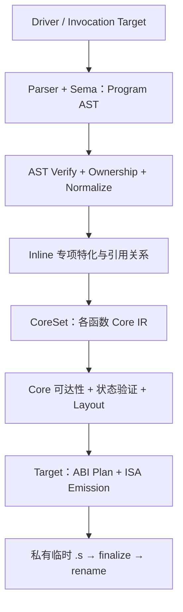

# MiniC 全局架构、阶段契约与数据所有权图谱

> **持续审计文档（living document）**。这是生产路径的事实图谱，不是一次性重构 RFC，也不代表全部源码已逐行审核。
>
> 首建：2026-10-30；第五轮审计起点：`b0870345b`（前次第四轮基线 `400f4a611`），分支 `refactor/minic-target-language-boundary`。代码演进后须更新入口、契约、证据及审计范围。
>
> 配套：[函数契约台账](minic-function-contract-register.md) · [缺陷、风险与架构债](minic-issue-register.md) · [架构原则](principles.md)。

## 1. 审计口径：先找真实所有者，再评价抽象

本图谱将五类判断分开：

1. **事实**：源码中的生产者、消费者、释放者及调用顺序，能由调用链核对。
2. **契约**：对输入、身份、生命周期、允许的状态修改及失败回滚的约束。
3. **设计差异**：不同 ISA/ABI、声明能力与机器能力、源 ASM 与生成指令的差异；不能直接归为重复代码。
4. **已证问题**：有足够源码、动态或 GNU 差分证据，进入 `MC-xxx` 缺陷台账。
5. **疑点**：缺少生产者/消费者或失败反例时保持待复核，不能推动破坏性重写。

函数长度、多个数组的相同下标、两条后端路径及 `probe = *parser` 的出现本身**都不是错误证据**。判断要落到实际允许的变更和物理拥有者上。

## 2. 用户可见入口与能力边界

| 入口 | 主要路径与责任 | 经核对的限制 |
| --- | --- | --- |
| `tools/minic/main.c:main` | 产品 driver：选择 target catalog 与 stage，组织工具进程、临时中间文件和清理 | `-S` 直接调用 `minic-cc -S`，输入须为已预处理 `.i`；不隐式运行 CPP。`-c`/链接的 staged toolchain 仅对 catalog 允许的目标开放，当前不是五目标同等阶段支持。 |
| `tools/minic-cc/main.c:main` | 解析 `--target/-march/-mabi/-fPIC/-fsigned-char/-fshort-wchar` 等；创建 invocation-local target | canonical `TargetInfo` 只读；语言 ABI 和机器选项改本次 invocation 副本；调用下面的 Compiler 入口。 |
| `src/compiler/compiler.c:minic_compile_preprocessed_file_for_target` | 单个已预处理 TU 的完整编译与释放入口 | 借目标描述；拥有 source buffer、Program 与 CoreFunctionSet；成功生成 `.s`，失败统一销毁内存；输出文件事务在 Target/common 层。 |

**关键边界：** `-S` 的五目标覆盖、GNU AS/ELF 链接覆盖、QEMU/原生执行覆盖是三种不同验收，不得拿一项推断另一项。测试口径见本文件末尾。

## 3. 当前真实生产管线

完整源码顺序以 `src/compiler/compiler.c:236–422` 为准：

| 次序 | 生产调用 | 读取 | 写入 / 返回 | 成功后的下游约束 |
| --- | --- | --- | --- | --- |
| 0 | `minic_read_file` | `.i` 路径 | heap-owned `MinicSourceBuffer.data` | Parser 在读取结束前借用该输入；最外层统一 `free`。 |
| 1 | `minic_parse_c0_program_for_target` | source、invocation Target | `MinicC0Program` 的 AST、类型、名字、全局/函数实体 | Parser 私有 scope/tag/enum/cache 与 Program 长寿命 arena 分别析构。 |
| 2 | `minic_c0_program_verify_target_detailed(PARSED)`、`minic_c0_program_validate_function_body_ownership` | Program | 无预期语义修改；临时验证索引 | 检查结构、类型及跨函数 Body 所有权；FunctionBody 的只读 visitor 对 overflow CALL 参数尚有同值写回（MC-030），因此不是严格物理只读。 |
| 3 | `minic_c0_program_normalize_casts` | 原 AST | 新表达式 arena + ExpressionId 重映射后提交 | 再次验证 NORMALIZED AST 和 Body 所有权。 |
| 4 | `minic_c0_program_recompute_inline_emission_references`、三个 `minic_specialize_inline_*`、`minic_finalize_inline_integer_specialization_references` | Program、Target | 追加 clone/Expression、更新 CALL 特化与 `is_referenced` | **有意仍修改共享 Program**；调用实例特化错误集中在这里，见 MC-001/006/007/008。 |
| 5 | `minic_prepare_core_function_set` | 特化完成后的 Program、Target | 为每个 `FunctionId` 预留 CoreFunction/status 槽，构建 reentry index，按 FunctionBody 降级 | `CoreSet.functions[i]` 与 `Program.functions[i]` 的对应关系由构造协议保证。 |
| 6 | `minic_prune_inline_specializations_from_core` | Program、CoreSet、backend reachability policy | 可调整 `Program.functions[i].is_referenced` | 这是 Core 降级后的定向引用选择；不是重新改写 Core 的语义指令。 |
| 7 | `minic_validate_core_functions`、`minic_data_layout_validate_program` | Core statuses、Program/Target Layout | 诊断，不创建目标机器结果 | 拒绝仍然活跃的失败函数和非法大小/布局。 |
| 8 | `minic_backend_emit_assembly` | immutable-for-emission Program/Core、Target | 分派五目标的 `.s` 发射 | Target 后端产生机器 ABI 和源 GNU ASM 的目标策略；编译端不选择指令。 |
| 9 | `minic_program_emit_write` 及目标 finalize | Program/Core、目标回调、目标路径 | `.s.minic-XXXXXX`，成功 close/finalize 后 rename | 失败删除临时文件，之前存在的正式 `.s` 不被半成品替换。 |
| 10 | `minic_core_function_set_destroy`、`minic_c0_program_destroy`、`free(buffer.data)` | 所有当前 TU 的 owned 状态 | 释放全部 | 即使中间失败，入口也走统一析构尾部。 |

**时序不变式：** 当前并不是「Parser 后 AST 永久冻结」。Normalize、Inline 和 prune 会更改 Program；只有进入单函数 CoreLower 时，AST 才按不可变源借用（它们之前的特化写入已结束）。进一步拆分阶段应先处理实际的**调用实例事实归属**，不能只按文件名划界。

## 4. 数据所有权、身份与借用生命周期

| 对象 / 句柄 | 真实分配与拥有者 | 谁读取 / 可能修改 | 不可突破的生命周期规则 |
| --- | --- | --- | --- |
| `MinicTargetInfo` canonical | Target catalog 中静态配置 | CLI/Parser/Core/Backend 只借用 | 调用选项应通过 `MinicTargetInvocation` 私有副本改变，不能污染另一次编译。 |
| `.i` SourceBuffer | Compiler 入口 malloc | Parser 借用文本、解析期间使用 | Program 析构后由 Compiler free；后端不保存裸 SourceBuffer 指针。 |
| `MinicC0Program` | Compiler 入口，`ast.c` 维护各 arena | Parser 构造，Normalize/Inline/prune 定向修改；Core/Target 读取 | Program 独占记录字段、名字、CALL overflow、各语义实体的析构责任。 |
| `FunctionId`/`RecordId`/`ExpressionId` | Program append 时的稳定整数身份 | 所有上游转换和下游 Core | ID 稳定，**元素内存地址不稳定**：arena `realloc` 后重新用 ID 获取；MC-001–003 违背的是借用指针有效期。 |
| `FunctionBody` 逻辑树/图 | `Function.body_block` 作为语义根 | `function_body.c` 校验跨函数 Block/Statement/Local/ASM/cleanup 边 | Program-wide arena 是物理储存，不等于每个 Function 拥有一段连续 ExpressionId；parser-time orphan expression 合法。详见 [FunctionBody 契约](function-body-ownership-v1.md)。 |
| Parser tags、enum、scope 等 | `MinicParser` 单独拥有的动态容器 | Tag/Enum 查找返借用指针，bind/add 会扩容 | 纯词法 probe 的浅拷贝未必有害；语义 parse 会写共享拥有型字段，MC-004/005 的浅拷贝确实违规。 |
| Core reentry index | CoreSet 生成期间创建、销毁 | 各函数 CoreLower 只借用索引；query 可更新统计器 | 原 Program 不可写；OOM 或证据不足时保守回扫，不能据不完整索引证明「无 reentry」。 |
| `MinicCoreFunctionSet` | Compiler 拥有，数组槽与状态一一对应 Program 函数序号 | 各函数 Lower 成功发表 Core IR；validate/Target 借用 | `function_count` 必须相同；未定义和无需发射的函数槽仍保留。并行数组同下标**不是偶然一致**。 |
| `MinicCoreFunction` | CoreSet 槽独占；函数 Lower 使用私有 `lowered` 构造 | Core API append/verify；Target 只借用 | Lower 成功验证后才 move 到输出；失败析构暂态且旧输出不变。**已发表 ID 稳定**；特殊 CSR `rK` 尾部消除会在严格验证后回退未发表的 Instruction/Value 计数并复用尾部 ID，不能泛称所有 Core ID 绝对单调。裸指针也不宜跨 append。 |
| `MinicCoreFunctionPlan` | `minic_program_visit_prepared_functions` 的单函数局部变量 | 各目标函数 emitter 借用 `facts` 和 `objects` | callback 返回后立即 destroy，目标不得持有内部指针越过回调。 |
| 机器 ABI/frame/call plan | 各 Target 函数 emitter 构建、析构；可转移子对象所有权 | 原生目标指令选择/ASM 访客 | RV32/64 与 A64/Loong 可共用事实/算法，但具体物理 ABI 仍由目标独立保证；失败时 caller 负责全部半成品。 |
| 目标 `.s` 路径 | `minic_program_emit_write` 临时文件事务 | 各 target callback 借用 `FILE*`，finalize 处理临时路径 | callback 局部写失败不会公开半成品；只在全部完成后 rename。 |

### 身份与对象地址必须分开

- `program->functions[i]` 与 `core_set.functions[i]` 对应 **FunctionId == i**：由 `minic_prepare_core_function_set` 创建同长度槽、`minic_validate_core_functions` 和 `minic_program_visit_*` 再次检验，而不是两个独立列表恰巧排序一样。
- RV32 CALL 也有明确构造顺序、`instruction_id` 和 prepared 校验；不是「两数组下标恰好相等」。
- `ExpressionId` 能准确标识单个共享 AST CALL，**不一定能标识某个 caller 中的一次动态/上下文特化实例**。MC-006 的根因是后者被错误折叠，不能据此否定稳定 ID 模型。
- `RecordId` 可稳定指向语义 Record；`MinicRecord*` 是借用，跨任何可能添加 record 的递归解析后必须重新取得。

## 5. 分层职责与可扩展性判断

| 层 | 应保留的职责 | 不应拥有的知识/状态 | 当前复核判断 |
| --- | --- | --- | --- |
| Frontend + Sema | C/GNU 语义、AST、ID、声明/表达式与类型规则 | 每目标指令编码/ABI 栈偏移；静态 TargetInfo 的可写全局状态 | 未发现依 `target->architecture` 直接选择机器发码的 Frontend/Core/Compiler 分支；由 TargetInfo/Policy 提供 C 语义差异是正当接口。**但 `frontend/type.h` 确有 AArch64 NEON/SVE 的源语言不透明类型身份及 MS-X64 调用约定身份**，不能说前端完全没有架构词汇。 |
| Compiler phase orchestration | 阶段顺序、验证、Inline specialization、CoreSet 和 TU 释放 | 机器 CALL 物理位置、目标指令细节 | 阶段入口清楚；Inline 的共享 AST 事实归属已存在实错。 |
| Core IR | 中立的值、效果、CFG、ASM operand 语义；局部事实和 reentry 证明 | 非可移植 ISA literal、机器寄存器/帧布局 | Lower/verify/计划基本分离；Core 能从共享 Program 中读出不正确的调用实例 provenance（MC-006/007/008）。 |
| TargetInfo/DataLayout/Source policy | 语言准入、目标特征、源 GNU ASM 资格、ABI/机器能力声明 | 替 Core 重写共享 AST；跨 invocation 的可变单例 | 有单一 target registration catalog；ISA 支持与主动 codegen 子集独立。 |
| Target/common | 全局遍历、Core semantic plan、临时输出事务、经事实证实可共用的 ABI-neutral 算法 | 平台寄存器数量、变参 caller-stack 相位、机器 opcode | `program_emit`、`program_visit`、FunctionPlan 分层有实在消费者，不应合并为一个巨型 driver。 |
| ISA backend | 寄存器与栈约定、调用/返回、选指令、目标 ASM/reloc/finalize | 重建 Parser、修改 Program AST 或假设别的 ISA ABI | 五目标独立配置。A64 与 Loong 共用 DirectLP64 **流程**，各自 ABI policy 独立；x86 Typed/Legacy、RV standalone/production 有真实分工。 |

### 加一个新目标应该改哪里

1. Target catalog/registration、TargetInfo/DataLayout、源语言及 GNU ASM 规则；必要时新增 ISA feature 与机器选项解析。
2. 目标 ABI（参数/返回/栈/变参）和发射 callback；复用 `Target/common` 的遍历、Core plan 与输出事务。
3. 目标独立 GNU assembler/ELF/QEMU 验证；不要求直接扩展 `Frontend` 的机器架构分支或复制 Core lowering。**例外**：新目标如果引入全新 C 可见 builtin 类型或函数调用约定，通用类型身份体系仍可能需要扩充；是否进一步数据驱动注册属于后续设计取舍。

**例外需要显式记录**：RV32 与 RV64 可共用 GPR cursor/word operations，却不代表共用 ILP32/LP64 帧；A64/Loong 的 DirectLP64 共用的是函数规划/输出的通用步骤，不是同一物理 ABI；源 ASM 资格与生成 ISA 指令是两类独立能力。

## 6. 当前阶段架构判断与未决问题

| 主题 | 已证实的当前状态 | 结论 / 下一验证 |
| --- | --- | --- |
| 稳定 ID 与 CoreSet 索引 | 生产者显式按源函数槽填充、消费者校验；Core 同步失败状态 | **合理设计，保留**；不要按“两个数组同下标”作为重构理由。 |
| Normalize 所有权 | 新表达式表、拷贝 owned payload、外部 ID remap 后提交 | **合理事务**；动态性质仍由逐批回归守护。 |
| Inline 实例事实 | shared CALL 被跨 caller 修改、整数+符号事实不能组合 | **已证缺陷 MC-006/007/008**；重构需把 `(caller FunctionId, Call ExpressionId)` 的实例事实归属单独表达。 |
| FunctionBody 只读接口 | `visit_expression_child_ids` 的浅拷贝仍通过可写 visitor 给 CALL overflow 同值赋值 | **MC-030 设计债**；单线程目前未证错编，未来并发读取不能依赖当前物理 const。 |
| Core 特殊尾部回退 | `core_inline_asm_rewind_dead_local_assignment` 同时检查 block 和全局连续尾部 ID/definitions 后缩小可见计数 | **合理但特殊**；已更正“全局始终单调、只留 tombstone”的旧误导注释，不应按普通 append-only 规则理解。 |
| Parser 语义 probe | `probe=*parser` 的 attribute 语义求值跨 owned 容器扩容 | **已证缺陷 MC-004/005**；其他词法 probe 不受同一判定影响。 |
| Parser Record 快照身份 | 静态 aggregate 使用栈上 `record_snapshot` 避免 Program arena 扩容使借用地址失效；字段路径 helper 却反算 `record - Program.records` | **MC-034 ASan pointer-pair 证实真实 UB**；快照本身有正确目的，应分离 Record 描述与稳定 RecordId 的传递。 |
| 字面量语义精度 | `parse_floating` 为 `long double` 先 `strtod`（binary64）再扩为内部 binary128；x86 x87 发射假定源是 binary64 | **MC-041 新增 P0 GNU-NATIVE-DIFF**；有效十进制 `L` 字面量与 GCC 本机执行结果不同，单改 Parser 而不检查 x87/四目标机器消费者会引出新问题。 |
| Record 零宽位域对齐 | `minic_data_layout_record_depth` 对所有位域同样先压缩 pack alignment，`int:0` 对齐栅栏被削弱 | **MC-042 P1 GNU-NATIVE-DIFF**：packed/pragma pack 下 GCC `offsetof/sizeof=4/5`、MiniC `1/2`；非 packed 输入正确；共享 DataLayout 可能影响其他 ISA，但仅 x86 有运行证据。 |
| 参数列表 tag scope | prototype、definition、function-pointer 的参数类型解析在进入参数列表前未建立正确作用域 | **MC-044 P1**：有效 GNU C 的外层同名 Record/Enum 被误判 duplicate，五目标同一 `.i` `-S` 均拒绝；函数定义 body 对其参数 tag 应继续可见，需带生命周期重建。 |
| Inline 特化预算 | 整数/布尔的 clone 数目限定为 2048/1024；耗尽时直接使整个 Compiler 失败 | **MC-043 P1 LOCAL-COMPILE-DIFF**：有效 2050 / 1025 个 distinct callsite 的 GNU 输入被错拒，阈值内正常；需要区分可选优化 budget 与真正必要静态特化。 |
| Runtime 范围初始化 | evaluate-once helper 借 Expression 指针、追加新 expression 后继续读 span | **MC-035 P0 已证 ASan UAF**：合法 GNU range initializer 在 Expression arena 容量边界触发。 |
| Runtime 嵌套数组 | borrowed ArrayType 跨递归解析，子 `sizeof(int[N])` 触发同一 arena 扩容 | **MC-039 P0 已证 ASan UAF**：14 个前置 ArrayType 触发扩容，第二个子数组读取旧地址。 |
| 匿名字段位置初始化 | promoted MEMBER leaf 的 field index 被误用作 outermost field 游标 | **MC-038 已证 x86 `-S` 合法 GNU C 错拒**；`.b=2,3` 失败，显式 `.c=3` 正常。 |
| Bool 两条证明 | CFG 剪枝与 local facts 的可达性/保守性政策不同 | **MC-019 架构债**；可抽共用 oracle，不可机械删任一路。 |
| Core ASM 多种 probe | 有序资格认领，target-required fail-closed | **合理差异**；要检查具体结果约束，而不是按多个函数名判重复。 |
| ABI varargs / packed ASM | RV32/64 过对齐 varargs 的保存区与 caller stack 有经过合法源码发射的地址不连续；Loong packed `add_unless` 结果写回实际走直接 `st.w` | **MC-010/014/015 第四轮从静态疑点补为可重放 `ASM-ONLY`**；无 GNU 目标/QEMU 运行证据，RV64 无剩余 GPR 的动态对齐分支已排除。 |
| RV32 指针宽化转换 | Core 认可 pointer→u64 的 `SCALAR_BITCAST`，RV32 的 1→2 word 发射器拒绝此 opcode | **MC-048 P2 编译接受缺口**；GNU C 有效、RV32 `-S` fail、RV64 同形 pass，尚不是运行时错码。 |
| RV64 `__int128` shift RHS | 宿主 GNU C 接受宽 RHS，当前 MiniC RV64 `-S` 拒绝；换窄整数 RHS 同目标可过 | **MC-028 已确认编译接受缺口**；尚不是 GNU RV64/ELF/QEMU 运行时错码证据。 |
| Core 标量更新事实 | 表达式语句 `++/--` 直达 scalar-update，通用表达式路径才会使 local constant 失效 | **MC-033 P0 实测错编**：x86-64 GNU 链接/运行与 GCC 不同；RV32/RV64/A64/Loong `-S` 均出现错误的分支消除，仅 x86 已执行。 |
| Record 条件表达式事实合流 | Record conditional 的 true/false/merge CFG 与 scalar fact fork/meet 不对称 | **MC-036 P1 已证 x86 GNU native 错编**；`f(1)` 应返 1，实际返 11，假臂 fact 污染 merge。 |
| AArch64 simple-global ELF type | target config 选 `%object`，但非 extern 的 Common simple global 硬编码 `@object` | **MC-025 仍调查中**；调用链分歧真实，A64 GNU AS 接受性尚未实测，不能宣称失败。 |
| Loong 特殊 ASM 类型限定符 | Source policy 对 volatile 输出先去限定符，Machine emitter 却用完整带限定符 pointee 与无 cv 类型相等比较 | **MC-037 已复现 cpucfg/CSR 的 `-S` 编译接受缺口**；同形 source/emitter 门控归为一个根因，目标 GAS/QEMU 尚无证据。 |
| Loong futex 特化读写输出 | Source gate 接受 GNU `+r`，目标特化仅发固定零并回写，没有消费原始寄存器输入 | **MC-045 P1 ASM-ONLY**；`err=7` 的有效 GNU 源 `.s` 明确产生无条件清零，Linux 已知 `err=0` 不能代表全部 source contract，待 Loong runtime 验证。 |
| A64 来源布局 | 两条 A64 Linux ASM 辅助逻辑读取默认 RV64 DataLayout，眼下布局值相同 | **MC-046 架构债**，没有已证现时错编；应在未来演进前把当前 TargetInfo/Layout 传给真实消费者。 |
| Core 值事实 vs 可消除效果 | 常量事实在 IF/condition branch/switch 的消费者纯度要求不完全相同 | **MC-047 仅 INVESTIGATING**：8 路 CFG x86 GNU/native 全通过，其他四 ISA `-S` pass，暂不因设计风险重写 Core。 |
| 自动化验收 | 某些 source-only 脚本把源码检查标成 QEMU/ELF | **MC-011/012/013**；验证等级必须进入报告，而非整体称“通过”。 |
| 静态初始化器的两种不安全借用 | 静态链式数组设计符留 `ArrayType*`；Record 后向覆写留 `Record*`，其间的 `sizeof(type)` 语义解析都可能扩容相应 Program arena | **MC-049 / MC-023 均 P0 ASan**；稳定 TypeId/RecordId 与值型 header snapshot 是正确修复方向，不能因正向已有保护就认为后向安全。 |
| Core long double 一元运算 | float/double 的 Core NEGATE 与 long double `__subtf3(0,x)` 路线分叉 | **MC-051 P1 GNU-NATIVE-DIFF**：`-(+0L)` 真实错成 `+0L`，并非字面量 MC-041 同一根因。 |
| x86 特化 ASM 类型门控 | Source 六种 GNU 特例对输出先去 cv，Core 正确携带 lvalue pointer，机器发射再用 raw pointee type equality | **MC-050 P2 LOCAL-COMPILE-DIFF**：六家族 plain -S PASS、volatile FAIL；三个安全子例 GNU/mixed native PASS，不能虚报 volatile MiniC runtime。 |
| AArch64 uaccess 输出宽度 | Source 接受 LDTRB/H/W 的 1/2/4B output，Machine 无条件使用 8B `str x10` | **MC-052 P1 ASM-ONLY**：可覆盖相邻 packed 字段；只证 `.s` 地址和物理宽度，无目标 GNU GAS/QEMU。 |
| RV64I softfloat 能力 | LP64 与 ISA F/D codegen 相互独立；基本四则已有 libgcc 桥接，比较/取负/转换没有同等 helper | **MC-053 P2 LOCAL-COMPILE-DIFF**：RV64I/LP64 十例 0/10，RV64IMAFD/LP64D 10/10，属于显式拒绝的能力缺口，不等于错误机器码。 |
| Core 验证器辅助数组 | 主 Core arena 有存储形状 preflight，fixed bindings、enum_types 没有相同先检验 | **MC-055 P3 INVESTIGATING**：仅手构 malformed Core 的 fail-closed 风险；有效 C producer 目前遵守不变式。 |
| Inline symbolic 过时判定 | `minic_inline_symbolic_static_expression_depth` 中局部值路径有 `&& false`，但其余 symbolic closure/legacy fallback 有生产消费者 | **MC-054 P3 DEBT**：可小范围清理恒假代码，不可据此删除整个函数或回退算法。 |

本轮以源码、调用链、所有权和已有测试证据交叉审核，**不是一次性重写授权**。优先补准契约与测试，问题可入台账挂起；若以后进入修复批次，应先验证所有相关消费者和旧路径是否还需要，再删除旧实现。

### 第五轮复扫：模块级结论要与函数级阅读轴并存

六个审计分片额外交付 `F5-M01..M28`（Target Common）、`F5-C01..C30`（Compiler/Driver）、`F5-F01..F30`（Frontend）、`F5-IR01..IR30`（Core）、`F5-R01..R30`（RISC-V）、`F5-A01..A30`（AArch64）、`F5-X01..X30`（x86），合计 **208 个函数/函数组审计入口**，不是 208 个此前完全未读过的独立 C 函数，也不是 332 个 C/H 文件全部 R2。部分行涵盖相互关联的 helper；x86 `X10/X27/X28` 仍为 R1/U1，其余按具体行的证据层声明。完整 contracts 和源位置在[第五轮函数表](minic-function-contract-register.md)。

重要跨层模型：Frontend AST 中稳定的 `TypeId/RecordId` 与可扩容的 `ArrayType*/Record*` 地址有不同生命周期；Core SSA/CallView 是语义载体，实际 output 宽度和可用软 float helper 必须由 ISA/ABI consumer 明确保证；GNU ASM Source 准入与 Machine emitter 是**同一 contract 的两端**，不能各自任意重定义 volatile、lvalue 宽度；可选 Inline 优化预算和编译正确性不可混为一谈。下一轮继续优先找全局 owner 与消费者之间的差异，使用独立 ASan、GNU native、GAS/ELF/QEMU 的真实证据逐级封闭问题。

**覆盖边界：** A64 `source_policy`/`fp_emit`/`residual_emit` 全读，`asm_contract.c` 仅关键区段 R2；x86 `source_policy` 全读，两个万行级 ASM 源/机文件仅配对 30 组，不应声称长尾全量读完。所有目标新测试主要是 `-S` 源/汇编和 x86 原生可执行差分；本轮未对新 MC 条目跑 A64/Loong/RV 的目标 QEMU。

### 第四轮跨层回看：为何不能由新 Bug 推出要重写某一层

- MC-041 是**前端的数值创建和后端可表示范围共同定义的契约**。目标支持 `long double` 的 ABI 并不足以证明前端已经保存该目标精度；中间 binary128 也不足以证明 x87 能完整发射它。
- MC-042 是**所有 ISA 共用的 DataLayout 被合法 C 特例击穿**，不能在各目标 ISA 发射器分别补一份字段偏移算法；但每个 ABI 的位域规则仍需目标 GNU oracle 独立检验。
- MC-044 是**类型身份作用域生命周期**出错，不是 Record arena 指针是否稳定的问题；要同时保证参数标签在函数体内可见、函数体外不可见，以及嵌套 prototype scope 结束。
- MC-043 是**可选特化配额与语义正确性混在一个布尔返回值中**；这与 MC-006/007 的调用实例事实所有权不同，不能以“统一 Inline 算法”为由一次消除所有检查。
- MC-014/015 是**物理 caller SP 与 realigned frame SP 的身份分离**；共享 GPR placement 算法可保持，具体 `va_list` 向 caller 栈切换必须交给各 ABI 独立保证。

## 7. 验证与审计覆盖分级

函数审计另有**阅读 `R0→R2`**与**理解 `U0→U2`**两条独立进度轴，细则和逐函数记录见[函数契约台账](minic-function-contract-register.md)。函数体已读、已追踪消费者、已建立契约、已证明某个可达错误是不同结论；文档只按实际完成的维度升级。源码注释着重记下非显然的不变式及所有权边界，未证实风险仍在 [MC 台账](minic-issue-register.md)中保持 `INVESTIGATING`。

| 级别 | 代表什么 | 不代表什么 |
| --- | --- | --- |
| `SOURCE-TRACE` | 核对函数入口、真实 caller、owner、变化与析构路径 | 不是 ASan/QEMU 执行成功。 |
| `ASAN / LSan` | 某反例上的真实内存越界、悬空或泄漏证据 | 无报警不等于所有容量/分支安全。 |
| `GCC-DIFF / ELF-ORACLE` | 预处理输入、产物、重定位或执行语义差分 | `-S` 生成了文件不等于正确链接或执行。 |
| `GNU AS / ELF` | 汇编器与目标文件验收 | 不代表 ABI 在目标机器上工作。 |
| `QEMU / native` | 真实目标执行验收 | 不代表覆盖所有 CFG/ABI/ASM 路径。 |

### 第四轮验证门禁实测边界

另独立运行了 `tools/ci/linux-three-isa-gnu-qemu-v1.py --self-test`（`THREE_ISA_GNU_QEMU_SELFTEST=PASS`）、`linux-three-isa-strict-source-gate-v1.py --self-test`（`MINIC_S_FULL_COVERAGE_SELFTEST=PASS`，17 个负例）、`linux-three-isa-summary-phase-selftest-v1.py`（`MINIC_THREE_ISA_SUMMARY_PHASE=PASS`）。源码已核对 GNU QEMU oracle 与 MiniC `-S` 三架构七分片 candidate 的证据身份、阶段标签分别采集；**这些是脚本的 fail-closed 自测，不是本轮实际重跑 Linux 全量 QEMU 或证明 MC-011/012 所涉旧脚本已修复**。历史脚本的虚标问题须在它们自己的消费者链和精确 HEAD 上处理。

上轮跟踪的 `src/` 范围为 **332 个 C/H 文件**，分布 `Frontend=70`、`Compiler=11`、`Core=45`、`Target=206`；Driver/工具入口另外审查。本轮逐条验证的是本文件中的关键生产链及 [函数契约台账](minic-function-contract-register.md) 已列函数，不应称所有源函数均已逐行深读。Target 上轮账本 `Full=7 / Targeted=4 / Pending=195`，因源码漂移还须重做过期记录；旧 `PASS` 仅说明当时指定契约通过。

## 8. 持续维护流程

1. 改一个阶段/Target/函数之前，在 [函数契约台账](minic-function-contract-register.md) 确认读写集与生命周期；没有的先补。
2. 发现可疑情况先查 [问题台账](minic-issue-register.md) 的 `CLOSED-NOT-A-BUG`，并追溯生产者—所有权—消费者—失败路径。
3. 有反例或新证据才将疑点升级为 `OPEN`；先补可复现测试再考虑修复批次；旧实现只有证明无真实消费者才能删除。
4. 变更完记录精确 commit/HEAD、四个证据级别的真实执行结果；同步更新全局图谱、函数台账与 MC 状态。
