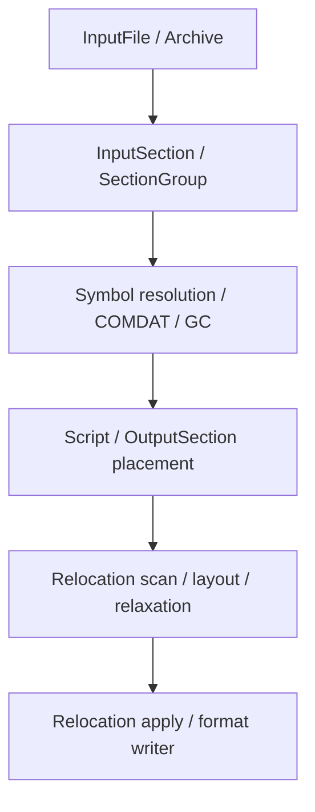

# MiniLD input-section architecture and MiniAS contract (2026-11-03)

Status: **InputFile/InputSection ownership, COMDAT, `-r` group preservation,
GC/linker-script input selection, OutputPlan and final symbol-table view
implemented for the current RV64 ELF subset**.  The remaining structural
work is to split original input symbols from global winners, move final
metadata/PHDR decisions out of both writers, and eliminate early input-section
merging entirely. This document retains the original historical source review
and successive checkpoints; it does not reopen MiniAS or claim a new Linux
runtime acceptance result.

## Scope and comparison baseline

GNU GCC is the compiler driver, **not** the implementation of GNU `ld`.
Compare MiniLD with GNU Binutils (`gas`, BFD, `ld.bfd`) and LLVM (`MC`, LLD):

- [GNU BFD linker functions](https://sourceware.org/binutils/docs/bfd/Linker-Functions.html),
  [BFD relocations](https://sourceware.org/binutils/docs/bfd/Relocations.html),
  [GNU ld SECTIONS](https://sourceware.org/binutils/docs/ld/SECTIONS.html):
  preserve input BFD/section/relocation identity, choose and place input
  sections via linker script, then apply target relocation policy.
- [LLVM LLD design](https://lld.llvm.org/NewLLD.html),
  [LLD ELF InputFiles](https://github.com/llvm/llvm-project/blob/main/lld/ELF/InputFiles.cpp),
  [LLD ELF Writer](https://github.com/llvm/llvm-project/blob/main/lld/ELF/Writer.cpp):
  distinct input files, input sections, symbols, output sections and writer.
  ELF/COFF/Mach-O have separate native linker implementations; do not invent
  a single cross-format writer prematurely.
- [LLVM MC](https://llvm.org/docs/CodeGenerator.html) and
  [RISC-V linker relaxation](https://docs.riscv.org/reference/abi/riscv-elf-linker-relaxation.html):
  the assembler emits link-time fixup information; the linker is responsible
  for final address-dependent decisions and resulting fixup adjustments.

**Chosen compatibility oracle:** GNU RISC-V ELF linking semantics, while
borrowing LLD's clear object ownership and phase separation. Retain existing
GNU archive/group extraction behavior; LLD's archive extraction ordering is
not always an identical observable contract.

**Initial target:** RV64 ELF with the current static / shared / relocatable
surface, and the separately implemented RV32 compatibility vDSO path. The
future target boundary must accommodate RV32, x86-64, AArch64 and LoongArch64,
but the first refactor must not imply those full linkers already exist.

## Original implementation baseline, before the 2026-11-03 migration

| Owner / operation | Current code | Observed contract |
| --- | --- | --- |
| Object/link state | `linker/src/linker_core.inc:19-100` | One flat `MiniLdState`; `MiniLdSection` simultaneously models early input material and final layout material. No durable `InputFile`, `InputSection`, `SectionGroup`, `OutputSection`. |
| Input merge | `linker_core.inc:598-649,852-1166` | `find_or_add_section` joins by name as each ET_REL arrives; symbol values and relocation offsets are immediately rebased. |
| Global binding | `linker_core.inc:681-774` | Strong/weak definitions resolve before there is a COMDAT group winner. |
| Input restrictions | `linker_core.inc:798-816` | Explicitly rejects `SHT_GROUP`, `SHF_GROUP`, `SHF_LINK_ORDER`, `SHT_REL` and `SHT_SYMTAB_SHNDX`. These differ in required support scope; do not blindly accept them. |
| Archives | `linker_core.inc:1345-2213` | Thin/regular archives, whole archive, unresolved-symbol extraction and groups are already implemented; preserve their current semantics. |
| GC reconstruction | `linker/src/linker.c:94-793` | Reconstructs input boundaries from `STT_SECTION`, then repairs order, output class and alignment because they were lost at input merge. |
| Script / GC | `linker/src/linker_script.h`, `linker_core.inc:3431-3505`, `linker.c:985-1005` | Parser records `KEEP`, but matching takes only section name; `--gc-sections` plus script is currently rejected. |
| Static layout/relocation | `linker_core.inc:2367-5609` | Implements RISC-V ALIGN NOP shrink, HI/LO and other relocations, GOT, layout and ET_EXEC output. Not full instruction relaxation. |
| Shared path | `linker_core.inc:5610-8390` | Existing ET_DYN/PIE metadata, GOT/PLT/TLS, versioning, dynamic relocations and shared output; preserve them. |
| `-r` | `linker_core.inc:2215-2365,8549-8577` | Emits ET_REL through MiniELF writer and retains relocations, but only *after* destructive input-section merging. |
| Shared object writer | `elf/include/minielf.h:115-146`, `elf/src/relocatable_writer.c` | MiniELF **already exposes** `has_group`, signature, `group_flags` and `has_link_order_target`; MiniLD's `write_output()` currently does not populate them. Extend this existing contract rather than inventing a second ELF group serializer. |
| RV32 vDSO | `linker/src/elf32_compat_vdso.c` | A narrower explicit special path, not general multi-ISA input support. |

The key invariant currently broken is **an input section remains identifiable
from ET_REL parsing through COMDAT, script selection, GC and relocation scan**.
The GC recovery heuristic proves why patching consumers one by one is fragile:
original file identity, group membership and `sh_link` relationships cannot
be reconstructed reliably from a merged byte array.

## New ownership and ordered data flow

The following models are **distinct owners**, not aliases for the existing
`MiniLdSection` type:

1. **`InputFile`** owns source path, archive member provenance, immutable
   ELF class, machine/ABI flags, source section-index table, local symbol
   table and the source object's original ordering.
2. **`InputSection`** owns its original `(file, shndx)` identity, independent
   alignment, bytes/NOBITS size, type/flags/entsize, original `sh_link` and
   `sh_info` relationships, group membership, relocation list and liveness.
   Two `.text` or `.text.foo` sections are *not* the same object merely
   because their names match.
3. **`SectionGroup`** owns `SHT_GROUP` flags, signature symbol, member input
   section IDs and selected/discarded status. Resolve COMDAT winner before
   reporting strong-symbol collisions; all members share group discard fate.
4. **`Symbol` / global `SymbolTable`** keep source-file symbol identity and
   winning definition separately. Undefined, common, weak, hidden, GNU-unique
   and IFUNC must have explicitly bounded semantics, never accidental enum
   fall-through. A relocation references a stable source symbol/section.
5. **`OutputSection`** owns output name/type/flags and ordered references to
   live input sections, not prematurely concatenated input bytes. A mapping
   `(input section, input offset) -> (output section, output offset/address)`
   becomes valid after placement and is recomputed when relaxation changes
   sizes. The writer serializes the final mapping.
6. **`Target` policy** owns machine/ABI validation, e_flags merge, relocation
   expression and pairing, range checks, GOT/PLT/TLS decisions and legal
   relaxations. Object format owns ELF-specific SHT/SHF/STT/R_* serialization.

### Phase invariants

- **Input discovery and archive extraction:** archive lookup may inspect
  unresolved global names, but cannot discard section/group identity. Handle
  group selection before treating a candidate duplicate strong definition as
  a final conflict. Reject invalid group indices/signatures with a diagnostic.
- **Input selection:** process COMDAT, dependency/order (`SHF_LINK_ORDER`),
  GC roots, `SHF_GNU_RETAIN`, script `KEEP`, `DISCARD`, archive/file-qualified
  script matching, and section-group liveness against original InputSections.
  `KEEP` must be consumed by GC, not merely parsed.
- **Placement:** apply script output section descriptions and their real
  sorting/alignment/order requirements; map each surviving InputSection into
  exactly one OutputSection. Account for COMMON and synthetic GOT/PLT/TLS
  sections with explicit ownership.
- **Scan:** examine relocations without applying final bytes; determine
  reference dependencies, dynamic relocations, GOT/PLT/TLS and possible relax
  sites. Preserve HI20/LO12 and SET/SUB relocation pair relationships.
- **Layout / relax:** recompute address-dependent sizes and placements until
  stable, with a termination condition and range diagnostics. `R_RISCV_RELAX`
  is a permission marker, not an instruction to ignore; `R_RISCV_ALIGN`
  reserves shrinkable padding. Update symbol values, reloc offsets and
  address-dependent CFI/LEB when a relaxation changes code size.
- **Final apply:** write target fixups only after stable layout. In `-r`,
  *do not* apply final-address relocations; emit correct remapped symbols,
  groups, `sh_link/sh_info`, associated sections and remaining relocations.
- **Output:** keep existing static ET_EXEC, shared ET_DYN/PIE and ET_REL
  coverage. Use explicit ELF writer ownership; later COFF/Mach-O need their
  own format semantics rather than inheriting ELF assumptions.

The implementation batch is complete only when the old reverse-engineered
GC section reconstruction can be deleted *and* `--gc-sections` plus linker
script can use the same input-section selection path. Retain the existing
Linux-cache-efficient relocation CSR index as an optimization after the
input-section owner switch; it should not dictate semantics.

## MiniAS -> MiniLD original gap ledger (before this migration)

| Contract | MiniAS producer | MiniLD current consumer | Correct next disposition |
| --- | --- | --- | --- |
| COMDAT and group sections | `assembler/src/common_lowering.c:425-650`, `assembler/src/elf_writer.c:28-68,308-328` | Rejected: `linker_core.inc:798-807` | Preserve group signature, select one group, enforce membership and `-r` preservation. |
| Link-order (`o`, `oG`) | Same lowering and ELF writer | Rejected: `linker_core.inc:798-807` | Keep linked target identity; coupled GC and placement. |
| Section merge/strings/unique | AS supports `M`, `S` and `.section ...,unique` | Name-only early merge | `SHF_MERGE`/`SHF_STRINGS` need entry-aware policy; source `unique` identity must not be destroyed. |
| `SHF_GNU_RETAIN` | AS emits flag | GC `linker.c:807-810` already recognizes | Preserve existing behavior; do not mislabel as missing. |
| `SET_ULEB128` / `SUB_ULEB128` | `assembler/src/riscv_target.c:110-111`; `mc_layout.c:1190-1304` | No final relocation handler in static/shared paths | Paired evaluation and correctly sized ULEB rewrite after layout. `-r` passes through. |
| `R_RISCV_RELAX` / `ALIGN` | AS emits permission/align records | ALIGN shrink exists; RELAX is skipped in final apply | Keep correct ALIGN and add legal instruction shrink plus mapping/CFI updates in target policy. |
| RISC-V `e_flags` / psABI | `assembler/src/riscv_profile.c:292-342` | Initially `linker_core.inc:1156` simply bitwise ORed flags | Addressed separately during this review: a Target-specific compatibility helper now rejects mixed code float ABI/RVE, unions RVC/TSO, and matches GNU's data-only input exception. |
| GNU symbol kinds | `assembler/src/elf_writer.c:79-97` emits `STB_GNU_UNIQUE`, `STT_GNU_IFUNC` | `linker_core.inc:1054-1079` rejects GNU_UNIQUE; IFUNC link semantics absent/unclear | Fail closed until well-defined policy, rather than falsely treating IFUNC as an ordinary function. |
| Native RV32 and other ELF targets | MiniAS has RV32/RV64, i386/x86-64, AArch64, LoongArch64 writers | Generic MiniLD input requires ELF64 little-endian `EM_RISCV` | Do not mix format/ISA expansion into the initial identity refactor. |

### What must *not* change in MiniAS without an oracle

MiniAS architecture was closed in
[`assembler/docs/minias-architecture-closeout-2026-11-03.md`](../../assembler/docs/minias-architecture-closeout-2026-11-03.md).
Existing `TargetSpec`, MC/Fragment/Fixup, object-model and writer ownership
are sound enough for the current scope. In particular, changing the default
RISC-V `relax` policy affects generated relocations, CFI and address-sensitive
LEB; decide jointly with actual GNU/MiniLD mixed-link oracles, **not** by a
global assembler flag flip.

## Implementation batch and acceptance boundaries

This is **one coherent data-model migration**, even if reviewable commits
are used to checkpoint it. Do not present temporary compatibility adapters
as architecture completion. Preserve performance on million-relocation
Linux objects and do not trigger full rebuilds for an LD-only edit.

1. Add input-file/section/group owners, parse complete section dependencies,
   keep section-local bytes, symbols and relocations. Move duplicate group
   selection ahead of global symbol conflict handling.
2. Wire COMDAT, link-order, GC and script `KEEP` to one section liveness
   decision, then assign ordered members to output sections. Remove the GC
   reconstruct/re-sort path once equivalent input ordering is proven.
3. Move target relocation *scan*, layout/relax and final *apply* into
   separate phases shared by static/shared output; do not duplicate machine
   relocation algorithms per output mode. Include ABI flags, ULEB pairs and
   `.eh_frame`-sensitive updates in this owner migration.
4. Keep `-r`/static/shared writers working; compare GNU layouts, symbols,
   ABI, relocations and actual runtime before promoting native LD coverage.

Reuse, rather than recreate, assembler oracle inputs:

- `tests/assembler/probe-comdat-groups.sh`
- `tests/assembler/probe-link-order-gcc-patchable.sh`
- `tests/assembler/probe-elf-sectionkey-unique-inherited-group-gnu.sh`
- `tests/assembler/probe-mc-leb-relax-gnu.sh`
- `tests/assembler/probe-target-profile-elf-isolation.sh`

For each focused fixture compare **GNU AS + GNU LD** (reference),
**MiniAS + GNU LD** (producer), **GNU AS + MiniLD** (consumer) and
**MiniAS + MiniLD** (integration). Include `-r` followed by final LD, script
`KEEP` + GC, group duplication, link-order target removal, and code
relaxation with ULEB/CFI references. No test is a pass merely because a
valid ELF file was emitted.

Retain existing `tests/linker/run-a0..a6.sh`, `run-script-a0/a1.sh`,
`run-gc-v0.sh`, and five
`tools/ci/minild-linux-cache-{reloc,final,purgatory,vdso64,vdso32}-replay-v1.sh`
entrypoints. The latter reuse frozen Linux 6.6.143 objects and **must not**
be mistaken for full-image QEMU P1 acceptance. Historical
`docs/ci/mini-native-chain-progressive-gates-2026-10-13.md` records a GNU
`purgatory.chk` symbol/layout/function-size difference; this remains an
oracle to **replay**, not a current-head regression result.

### Evidence from the 2026-11-03 inspection

- Working branch at start: `refactor/minias-target-isa-abi-core`, HEAD
  `a6d839d`. Branch was **ahead 17 / behind 9** relative to the local
  remote-tracking ref. No merge or force-push is justified by this review.
- `make check-minild-script-a0`: **PASS** (host-only Linux script parser,
  wildcard and PHDR/version probe), before source changes.
- Local environment lacks RISC-V GNU cross tools, LLD and QEMU, as well as
  a usable cached GNU Kbuild object tree. Therefore **no new GNU-vs-MiniLD
  RV64 diff, Linux replay, or Linux runtime pass is claimed**.

### Bounded correctness follow-up from this review

The independently testable RV64 ELF e_flags policy is now extracted into
`linker/src/riscv_elf_abi.{h,c}` and used by the ET_REL input path.
The rule follows the actual [GNU RISC-V BFD merge policy](https://gnu.googlesource.com/binutils-gdb/+/32f0ce4db98eb1e8e1cc326d3a22ef0c436ae6fe/bfd/elfnn-riscv.c)
and its later [Ztso merge change](https://sourceware.org/pipermail/binutils/2022-September/122977.html):
FLOAT_ABI/RVE conflicts on code objects fail, RVC/TSO flags can accumulate,
and a later data-only input cannot force a code-ABI conflict. This does
**not** implement the major InputFile/InputSection/SectionGroup migration.

Host-only validation: `make check-minild-riscv-abi`
(`compatible=8 rejected=4`) and
`make check-minild-riscv-abi-integration` (MiniAS-produced code/data RISC-V
ELF objects, `-r` output flags, incompatible-float rejection) both passed;
`make check-minild-script-a0` remained PASS. A separate
`tests/linker/probe-as-ld-section-contract.sh` originally **BLOCKED** on
COMDAT and link-order metadata. That historical failure provided the oracle
for the subsequent implementation; see the new checkpoint below.

## Input identity / GC implementation checkpoint (2026-11-03)

The first nontrivial implementation batch now replaces the GC input-boundary
heuristic, while preserving the existing static, shared, archive and `-r`
linking paths:

- Each admitted ET_REL object creates a persistent `MiniLdInputFile`, with its
  own source path and `original shndx -> InputSection` index table. Each
  supported source section retains its individual header fields, exact
  bytes/NOBITS size, alignment, original `sh_link/sh_info`, merged placement
  and stable admission order. These owners deep-copy borrowed data from both
  thin/regular archive members before the archive storage is released.
- Source symbols and relocations keep input-section IDs and original offsets
  in addition to the existing legacy output coordinates. In the global
  weak-to-strong definition replacement, source provenance follows the
  winning definition. Synthetic script symbols have no input owner.
- In the GC static path, `minild_gc_restore_input_sections()` now creates
  output fragments from *original section payloads*, without reconstructing
  boundaries from `STT_SECTION`. It does not ingest inter-section alignment
  padding, and each fragment carries its own alignment. The old merged
  placeholder buffers are released and their alignment reset to one.
  Subsequent ordering/class/alignment moves also remap source-section IDs.
- This is a real consumer of the input owner for GC. It is **not** yet the
  final `InputSection -> OutputSection` architecture. Normal linking still
  merges by name on admission, and global symbols are still resolved
  incrementally to preserve current lazy-archive semantics. A separate
  source symbol/group selection pass must precede full COMDAT admission.

Host-only positive gate:
`make MODE=release CFLAGS=-Werror check-minild-input-section-gc`.
`tests/linker/input_section_gc_fixture.c` deliberately generates RISC-V ELF
input with three identical `.text` names, alignments 4/16/64, **zero
STT_SECTION symbols**, an unreachable undefined relocation and a preceding
weak definition of the live symbol. `probe-input-section-gc.sh` checks
original symbols/sections/relocations and final ET_EXEC layout. Result:
`MINILD_GC_INPUT=PASS` (source identity, dead relocation discarded,
strong-over-weak). This does not rely on QEMU or substitute for GNU runtime
comparison. Host script and ABI gates remain PASS.

Historical AS/LD contract gate at this checkpoint:
`make MODE=release check-minild-as-section-contract` **BLOCKED 3/3** on
the old `SHT_GROUP`/`SHF_GROUP`/`SHF_LINK_ORDER` rejection, while the MiniAS
source objects passed their metadata checks. This is the *before* state;
the next checkpoint documents the resolved MiniAS/MiniLD integration.

## COMDAT and LINK_ORDER integration checkpoint (2026-11-03)

The next coordinated batch builds on immutable source `(file, shndx)` IDs:

- Parse `SHT_GROUP` headers before section admission and global symbol
  resolution. Reject malformed/orphan group members, select the first COMDAT
  definition by signature and omit losing-group bytes, symbols and relocation
  records. Selected groups retain source membership and signature symbols.
- Preserve distinct group members, same-named LINK_ORDER targets and metadata
  during both `-r` hops. Re-emit `SHT_GROUP`, `SHF_GROUP`, `sh_info` signature,
  group-member relocations, and each metadata section's remapped `sh_link`
  through MiniELF's existing relocatable writer.
- During final static GC, materialize live candidates from exact source
  sections. Reachability propagates from a live COMDAT member to its fellow
  members and from a live LINK_ORDER target to its dependent metadata, **not
  the reverse**. Non-allocating LINK_ORDER sections participate too. Every
  section reorder remaps links; ET_EXEC and ET_DYN writers resolve the final
  target index into the emitted `sh_link`.
- Retain the legacy `MiniLdSection` materialization and name merge outside
  `-r` and static GC as an interim adapter. This is a correctness milestone,
  **not** a completed input/output ownership split or script `KEEP` + GC.

Host-only reproducible gates, built with `CFLAGS=-Werror`:

| Gate | Current result |
| --- | --- |
| `check-minild-as-section-contract` | **PASS, 4 cases × 4 stages** (direct final+GC, `-r`, second `-r`, final+GC). Duplicate COMDAT loser with an unresolved symbol; distinct COMDAT signatures with same-named sections; live/dead LINK_ORDER metadata; two COMDAT groups sharing target and metadata section names, including nonalloc `oG`. |
| `check-minild-input-section-gc` | **PASS** (input boundaries without `STT_SECTION`, distinct alignment, dead undefined relocation, strong/weak winner). |
| `check-minild-riscv-abi`, `check-minild-riscv-abi-integration` | **PASS** (8 compatible/4 rejected, mixed MiniAS ELF `e_flags`). |
| `check-minild-script-a0` | **PASS** (host-only Linux script/PHDR/version probe). |

GNU RISC-V AS/LD are absent in this workspace: the contract probe explicitly
reports `gnu_oracle=0`. QEMU/Linux runtime and frozen Linux object replays
have **not** been run and must not be reported as passing.

At this checkpoint, the next semantic work was linker-script selection and
ordered placement against persistent `InputSection`. The following checkpoint
records that integration. The independent `OutputSection` owner remains next.

## Script selection and GC integration checkpoint (2026-11-03)

Static `-T` plus `--gc-sections` now runs through the existing script parser
and the original-input GC path instead of being rejected. This is a single
source-identity selection path, **not** a second script parser:

1. Parse the script, validate the same supported static subset as the
   existing non-GC path, and choose the entry (`-e`, script `ENTRY`, `_start`).
2. Restore original input fragments and admission order. Walk script output
   commands in order, recording the first matching pattern on its original
   `MiniLdInputSection`. `KEEP` becomes an explicit root; `/DISCARD/` becomes
   an exclusion **before** relocation-based GC; unowned COMMON/nonalloc
   sections also follow the selection policy.
3. Traverse entry, `KEEP`, builtin init/fini, `SHF_GNU_RETAIN`, relocations,
   COMDAT and LINK_ORDER dependencies. Match init/fini against their *source*
   names, never the generated `.__minild_gc_*` internal identifier.
4. Perform script placement **after** GC, matching source section names and
   ignoring dead fragments. The same source fragment can now carry the script
   output name independently of its internal unique identity; sorted pattern
   matches still respect admission order, and both output VMA and `AT` LMA
   use the existing proven evaluator. Default no-script GC class reorders do
   not run on the script path.
5. Empty merged source holders stay discarded. Synthetic COMMON `.bss` and
   GOT sections can revive such holders when actual new bytes are allocated;
   the GC tombstone must not hide their content.

New host-only gate:

`make MODE=release CFLAGS=-Werror check-minild-script-gc-input`

Result: `MINILD_SCRIPT_GC=PASS stages=3` (non-GC baseline, direct final+GC,
`-r` then final+GC). It covers KEEP-only retained code, `/DISCARD/`,
unreferenced `.init`, dead undefined relocation, same-named source sections
in **direct** GC, script-selected output section names, and real `.bss`
coexisting with a live COMMON symbol (aligned, disjoint addresses). The earlier
COMDAT/LINK_ORDER, input-section GC, ABI and Linux-subset script A0 gates
remain PASS.

The tested GNU host `ld -r` also merges ordinary same-named input sections.
Their individual GC boundaries cannot then be recovered from a merged ET_REL
object (and a subsequent dead undefined reference fails under GNU too). The
test deliberately does not require MiniLD to restore information that normal
GNU `-r` has already discarded. COMDAT/LINK_ORDER retains its separate
ELF-prescribed metadata identity and existing four-stage gate.

**Remaining architecture boundary:** This batch preserves source identity,
selection and per-fragment layout, but a scripted output name on each
fragment is not yet one owned `OutputSection` containing an ordered list of
fragments. Static/shared ELF writers still use a section-index-per-fragment
view. True aggregation must remap symbol `st_shndx`, LINK_ORDER `sh_link`,
script-generated BYTE content, PHDR/TLS/CFI layout and relaxation offsets
in one cohesive later migration, without regressing Linux's existing script
expressions and archive resolution. The script parser still lacks GNU's full
file-qualified matching. No RISC-V GNU cross oracle, cached Linux replay or
QEMU runtime pass is asserted by these host-only gates.
